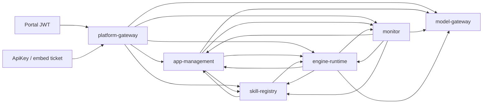

# G6 可信 IAM 与跨服务权限 Implementation Plan

> **For agentic workers:** REQUIRED SUB-SKILL: Use superpowers:executing-plans to implement this plan task-by-task. Steps use checkbox (`- [ ]`) syntax for tracking. 本次只规划，不派子 agent；后续是否委派由 root 单独安排。

**Goal:** 在不改变 v1.2 四契约和现有 ApiKey/SDK 对外签名的前提下，消费可信 IAM 的当前授权证据，实现门户声明上限、caller/target/action 限定的内部调用，以及后台恢复前的当前主体授权核实。

**Architecture:** 保留 Actor 作为业务身份投影，另设不可由请求参数构造的授权上下文。门户 JWT 仅在网关验证并向受信 IAM 交换；业务服务消费 IAM 签发的目标服务票据，每次敏感动作核实当前权限。后台 PG 快照只提供历史上限与资源归属，生产恢复必须取得有效委托引用及当前授权；本工程只实现 IAM 客户端适配和测试夹具，不新建生产 IAM/STS。

**Tech Stack:** Java 21、Spring Boot 3.5.0、Spring Security 6.5.0、Nimbus JOSE+JWT 9.37.3、Spring AI 1.0.0、PostgreSQL、现有 Servlet/RestClient；不升级框架，不新增业务服务 jar 依赖。

## Global Constraints

- 工作根目录仅 `G:/207/项目/算法重组工具/代码/agent-platform`；不读取相邻旧工程。
- 唯一设计依据 v1.2；`contracts/snapshot/detailed-design-v1.2.md` SHA256=`3c72b2062beb2e8b377f2384843ea935a0074b50c0063e5106566bbd8dcd0c4f`。本次只读核对摘要一致。
- 原四契约不改；模块 2 本体平台范围外。新增 IAM 适配协议是内部基础设施约定，不能回写冻结契约或冒充原设计已有接口。
- PG 是唯一业务权威源；跨服务 HTTP；tenant/principal 只能来自已验证身份。凭据仅 secret_ref；不读取或打印 `.env`、vault 文件、master key 或真实凭据。
- 发布门禁 `BLOCKED_IAM_SCOPE_ACCEPTANCE` 保持。没有生产 IAM 签收不得改为 `IAM_SCOPE_ACCEPTED`，隔离夹具通过也不例外。
- 本次只规划并按独立审查返修本文及自己的 baseline/diff/返修记录；未运行 Maven、未启停服务、未修改源码/测试/POM/部署/原四契约，未提交或发布。以下命令、文件和结果均为实施计划，不能作为已通过证据。
- 当前 846 是 brief 提供的已完成后端基线；skill expectedAttempt 297/独立 115 是其他任务证据，本任务未复测。算法协议由 root 下一阶段实施，本文不得并行修改 skill。

---

## 1. 现状核对：源码定位与不能成立的推论

以下路径均相对于工程根目录，行号是 2026-10-20 本次阅读定位；实施前按符号再次定位，不机械套用旧行号。

| 已读文件/位置 | 实际行为 | G6 缺口 |
| --- | --- | --- |
| `admin-common/src/main/java/cn/agentplatform/common/SecurityConfiguration.java:34`、`:118` | 同一个 HS256 decoder 接受 portal/internal，网关额外接受 integration；issuer 固定 `ServiceTokens.ISSUER`；internal 仅 `ROLE_SERVICE`；admin 排除 integration | 没有按服务限定 aud、caller 或 action；带 SERVICE 的 portal JWT 可经过公共 internal matcher，只有部分业务入口另验 purpose；不能当生产互信 |
| `admin-common/src/main/java/cn/agentplatform/common/Actor.java:21`、`:45` | 从 SecurityContext 的 Jwt 提取 tenant/sub/roles/attributes；requireRole 允许 ADMIN 代替普通角色 | 没有来源上限、scope、角色版本、新鲜度和委托链；ADMIN 不能继续作为内部服务能力的替代 |
| `admin-common/src/main/java/cn/agentplatform/common/ServiceTokens.java:16`、`:49`、`:85` | issue(actor) 直接复制角色属性并添加 SERVICE，统一受众 internal、120 秒；三类票据共用密钥，无 kid | 签名证明知道共享密钥，无法证明 caller；没有交集计算；任何旧 Actor 都可换票。issuer 配置项目前未用于 decoder 的 issuer 选择 |
| `platform-gateway/src/main/java/cn/agentplatform/gateway/api/GatewayController.java:34`、`:51`、`:114` | admin/v1 转发与 SSE、聚合 api-docs 均本地 issue；不直接透传用户 JWT | 应保留“不透传”；换成 IAM 受限交换，不能改成直接 Authorization 透传以求兼容 |
| `platform-gateway/src/main/java/cn/agentplatform/gateway/application/IntegrationAccess.java:30`、`:74`、`:88`、`:127`、`:164` | `_gateway` bootstrap 读取凭据；ApiKey 验密后裁剪并出票；每次校验凭据状态/策略摘要/绑定应用；CORS 通过专用服务查询 | bootstrap 是自报 Actor 加共享签名；应成为 IAM client 身份的单独机器动作；保留每次吊销检查 |
| `platform-gateway/src/main/java/cn/agentplatform/gateway/domain/IntegrationPolicy.java:16` | principalIds、roles、attributes 裁剪；禁止 ADMIN/EDITOR/SERVICE/GATEWAY_AUTH；bizSystemCode/userId 由可信凭据绑定 | 外部集成主体是 `biz:user`，不能直接假定它存在于门户 IAM 用户库；issuer 有效并不意味着可自报其他主体 |
| `app-management/src/main/java/cn/agentplatform/app/application/IntegrationService.java:102` | `_gateway`+SERVICE+GATEWAY_AUTH 允许全局凭据归属查询 | 用密码学认证的 gateway client 与精确机器动作替换字符串身份特例；不开放一般跨租户查询 |
| `app-management/src/main/java/cn/agentplatform/app/application/DraftMetadataService.java:20` | SERVICE+EDITOR，随后 tenant SQL | 业务 EDITOR 保留；SERVICE 独立替换为 caller/action 核验，避免生产移除 SERVICE 后草稿链断开 |
| `engine-runtime/src/main/java/cn/agentplatform/engine/infra/RuntimeClients.java:38`、`:58`、`:78`；`TestInputClient.java:36` | 各请求 issue(actor)；未知 service 默认落 model；模型 stream 单独 HttpURLConnection | 每条边显式 target/action；未知服务拒绝；流式路径同样取票、禁止重定向携带票据 |
| `skill-registry/src/main/java/cn/agentplatform/skill/infra/SkillClients.java:36`；`AppService.java:682`；monitor `EvaluationService.java:71`、`StatisticsService.java:259` | 各自实现 HTTP client 并本地签票 | 没有一个现存 `ServiceClients` 类。本文新增公共“取票接口”，复用现有 clients，不假称已读不存在的 ServiceClients |
| `engine-runtime/src/main/java/cn/agentplatform/engine/application/RunService.java:1539` | driveRecovered 从 PG guard_ctx 恢复完整旧 roles/attributes 后 drive | 没有当前 IAM 证据；即使旧 JWT 验过签也不能推断现在仍可执行或复用结果 |
| `engine-runtime/src/main/java/cn/agentplatform/engine/application/ChatHistory.java:16`、`:59`、`:79`；`ChatSessions.java:68`；`AgentDriver.java:75` | 新轮前 checkScope 用 Actor；load 比较旧轮 guard_ctx 与本轮持久 guard_ctx；已知 requestId 分支可恢复已受理轮次 | 更换恢复 Actor 不会自动修正 load 的旧对旧比较；创建、幂等重入、实际加载、检查点消费均须用当次可信证据 |
| `engine-runtime/src/main/java/cn/agentplatform/engine/application/ModelExchange.java:177`；`ContextProjection.java:93`；`ContextAssembler.java:38` | 独立 SUMMARY 调用和压缩摘要后进入实际消息；assembler 的 requiredLabels 来源为配置 | 摘要不代表脱敏；必须保留所有来源材料的许可要求和 dataLabels，不能仅检查配置标签 |
| `engine-runtime/src/main/java/cn/agentplatform/engine/api/RunController.java:112`、`:149`、`:202`；`model-gateway/src/main/java/cn/agentplatform/model/api/ModelController.java:119`；`application/ModelCalls.java:409`；gateway `GatewayController.java:81` | 开流捕获 Actor 后异步写事件/chunk/final，gateway 循环复制响应；安全 filter 不重入这些循环 | 需要明确响应租约/到期/撤权/网络故障的后续输出规则与集成当前响应例外，见 §2.4 |
| `engine-runtime/src/main/java/cn/agentplatform/engine/infra/ExecutionRecovery.java:24`、`:39`、`:60` | 定时器只恢复 tenant/principal，空 roles/attrs；读取 skill-facts 后采纳并重新唤醒运行 | 空 Actor 被 issue 自动加 SERVICE 可以读结果；采纳之后继续 drive 必须另行核当前范围；不能用恢复“只读”名义豁免受保护结果 |
| `skill-registry/src/main/java/cn/agentplatform/skill/application/SkillOutbox.java:22`、`:62`；`SkillExecution.java:920` | outbox 从事实归属重建 SERVICE Actor，仅投递已有事实，不重发适配器 | 机器投递动作与用户执行动作分开；读取/投递受保护结果仍需明确授权，撤权时保留待投递事实 |
| `skill-registry/src/main/java/cn/agentplatform/skill/application/SkillExecution.java:532`、`:564`；`ReconciliationProofs.java:35` | proof 归属受 tenant+principal 限制；reconcile 再做当前传入 Actor 与历史参数范围核对；对账 proof 检查 purpose/aud | 传入 Actor “当前”尚没有可信新鲜度保证；hard-coded 通用 aud 后续必须随目标 aud 一起替换 |
| `model-gateway/src/main/java/cn/agentplatform/model/application/ModelCalls.java:74`；`api/ModelController.java:80` | health worker 使用 `_model_health` SERVICE；内部 chat/measure 由公共 matcher 保护 | 健康检查属受限机器工作，不继承用户权限；模型请求、tokenizer 和历史 context 出域前必须消费当前证据 |
| `engine-runtime/src/main/java/cn/agentplatform/engine/infra/ToolCalls.java:388`；`application/ApprovalService.java:64` | approval 绑定参数/版本/到期与当前租约；批准时记录 approvedBy | 历史批准快照没有证明批准者现在仍有合法确认角色；G2 新代不得以发起人角色代替批准者证据 |
| `deploy/README.md:5`、`deploy/entrypoint.sh:4`、`deploy/check-release.ps1:11` | 明确阻断生产发布，dev-auth 禁止用于该部署 | 保留；配置开关不等于 IAM 功能或签收 |

已读的现有测试包括 `admin-common/src/test/java/cn/agentplatform/common/CommonBoundaryTest.java`、`platform-gateway/src/test/java/cn/agentplatform/gateway/IntegrationSecurityTest.java`，以及 skill callback/reconciliation、engine recovery/approval 测试的相关调用点。CommonBoundaryTest 直接装配 Jwt 或解析 base64，不能证明生产验签。IntegrationSecurityTest 覆盖 ApiKey、吊销、策略变更、CORS 和内部 token_use，但没有证明独立 caller 私有凭据或当前 IAM。新增测试不能复用这些旧“已验”对象代替签名 HTTP。

### 实际调用图与初始 action 清单



新增权限目录使用完整 Spring controller 路径模板加 HTTP method，一条模板一个 action；下面为必须覆盖的精确边族，不把族名作为运行时通配授权。`POST` 创建、更新、发布、确认与 `GET` 查看不能共享 action。runtime `RequestMappingHandlerMapping` 枚举全部非健康业务 handler，未登记/重复匹配启动拒绝；网关 Routes 只选择目标，不能授予权限。

| caller → target | 必须登记的路径/用途 | 最小 action 前缀与模式 |
| --- | --- | --- |
| gateway → 五业务服务 | 现有 `/admin/**`、`/v1/**`、`GET /v3/api-docs` 的具体 handler 模板 | `proxy.<target>.<method>.<handler>`；用户委托，integration 仅允许 IntegrationPolicy.allowedPath 的具体运行模板 |
| gateway → app | `GET /internal/integration-credentials/{id}`、`GET /internal/integration-origins` | `integration.credential.read`、`integration.origin.check`；机器身份，仅 gateway |
| 外部 authority 的独立 policy client → app | `POST /internal/iam/integration-policy/resolve` | `integration.policy.resolve`；独立签发/验证域，仅 `iam-policy-resolver`，不用普通 authorizeWorkload，见 §2.6 |
| 已登记的实际材料消费者 → 材料生产服务 engine/skill/model | `GET /internal/material-scopes/{kind}/{id}` | `material.scope.read`；用户委托、完整 subject/resource 绑定；未实际需要的边不授予，见 §2.5 |
| engine/monitor → app | `/internal/apps/{code}/candidate|versions/{version}|snapshot|published`、`/internal/app-drafts/{id}`、prompt-template 版本 | 分别 `app.candidate.read`、`app.version.read`、`app.snapshot.read`、`app.published.read`、`app.draft.read`、`prompt.version.read`；用户委托，只有实际调用边纳入 |
| app → skill/model/engine/monitor | skill 元数据、model-entry/binding freeze/validate、`POST /internal/graphs/validate`、`GET /internal/evaluations/accepted` | 元数据 read 与 freeze/validate 区分；当前 EDITOR/发布要求继续由域服务核对 |
| engine → skill | `GET /internal/skills/{code}`、`GET /internal/skill-versions/{id}`、`POST /internal/skills/{code}/execute`、skill-facts 的 read/reconcile/retry/reproduce-artifacts、reconciliation-proofs | `skill.metadata.read`、`skill.version.read`、`skill.execute`、`skill.fact.read`、`skill.reconcile`、`skill.fact.deliver`、`skill.artifact.reproduce`、`skill.reconciliation-proof.read`；不能互换 |
| skill → engine | `/internal/tool-calls/{id}`、`/{id}/approval`、`/{id}/claim`、`/{id}/submitted`、`/{id}/fact`；受控 draft test | `tool.authority.read`、`tool.approval.read`、`tool.claim`、`tool.submit`、`tool.fact.record`、`skill.draft-test.start`；fact 投递不授予 submit |
| skill → app | `GET /internal/skills/{code}/references` | `skill.references.read`；用户委托 |
| engine → model | `POST /internal/model/measure|chat|chat/stream`，binding/entry 读取或验证 | `model.measure`、`model.chat`、`model.chat-stream` 与元数据动作分开；当前数据标签/出域约束保留 |
| engine → monitor | `POST /internal/datasets/promotions` | `dataset.promote`；仍验证 debug input 所有权和冻结摘要 |
| monitor → engine | evaluations/run、approvals、audit、statistics、statistics/runs/{id} | `evaluation.run`、`approval.decide`、`approval.list`、`audit.read`、`statistics.read`、`statistics.run.read`；确认角色按本调用冻结的 confirmRoles，ADMIN 没有自动豁免 |
| monitor → skill/model | statistics、model statistics/query | `statistics.read`、`statistics.query`；仍要求用户 ADMIN |
| 已批准 callback service → skill | `POST /internal/skill-jobs/{callId}/callback` | `skill.callback.record`，独立注册 client；继续原 SignedCallback/body/time/idempotency/attempt 校验，不把该 client 扩成 engine |

`ToolCallController /register` 即使目前没有跨服务调用者也必须登记为明确禁用，不能因“内部”自动授权；后续新增 caller 另审。同样对现有 controller 中所有无调用边的 internal handler 默认禁用。上述清单是迁移工作表，最终完整逐 handler 清单在 Task 1 生成并逐条评审，运行时绝不从类名或 URL 前缀自动推断允许 caller。

## 2. 最小可成立的信任方式和评审决策

采用 **外部可信 IAM/授权服务签票 + 每次受保护操作在线核当前权限** 的客户端适配方案。只验证非对称 JWT 仍不足以即时发现撤权；只用 client_credentials 再附任意 tenant/sub 也不构成用户委托。现有 `issue(Actor)` 在生产禁止，不能设故障时自动回退。

### 2.1 三种用途和三个信任域

1. **门户 JWT**：受信门户 issuer/JWKS、显式算法、网关受众、`token_use=user`、访问 token 用途；tenant/sub 与 claims 上限配置按 issuer+客户端绑定。只由 gateway 接收，不能用于下游 admin/internal/v1。JWT 可作为 `subject_token` 交给明确配置的受信 IAM token endpoint，不能交给业务服务、模型/算法/MCP 供应商或其他 URL。
2. **内部服务票据**：由外部 authority 签名，`token_use=service`，aud 恰为 `urn:agent-platform:service:<target>`（建议命名）；签名声明 caller、target、action、tenant、sub、grant_ref、authorization_version、resource binding、iat/nbf/exp/jti。caller 来自经过 IAM 验证的专用 client 身份；客户端 body 中自报 caller/roles/attributes 不被 authority 采信。业务服务只拥有本服务 client credential 的 secret_ref，不持有 authority 签名私钥，也不共享其他服务 secret。
3. **外部集成短票据**：保持 `agent-platform-embed`/integration、`credential_id/app_code/biz_system_code/user_id/policy_digest` 和 ≤300 秒。HMAC 仍可以用于这个设计明确允许的集成出票域，但生产密钥只在专用集成签发/验证侧使用，与 portal/internal 信任完全隔离。不能把该 HMAC 加入任一业务服务 internal decoder 的 fallback。ApiKey 仍按现有验密、claim_limits 和吊销策略处理，现有 SDK 不改 Authorization 形式。

`Actor` 中的业务 ADMIN/EDITOR/APPROVER 可以保留既有域语义；生产 SERVICE/GATEWAY_AUTH 不再作为业务角色授予。服务能力来自独立 `VerifiedAuthority`。入口先验证服务能力，再执行现有 tenant/owner/guard/approval/版本约束；scope 不替代资源所有权。

### 2.2 委托获取与恢复：不是标准协议天然提供的能力

初次门户请求可使用 RFC 8693 token exchange：网关向 IAM 提供已验门户 token；IAM 验客户端、原 token、当前用户权限及可委托服务边，返回目标票据。下一个服务用收到的内部票据交换更下游票据，不能把原票据原样转发到另一 aud。

**持久委托引用 `grant_ref`、当前授权查询、恢复续票、批准者角色核实是本计划的 IAM adapter profile，原则已由 root 裁决接受，不能声称 RFC 8693 强制支持。** production adapter 消费实际 IAM 对应接口；本工程不实现它们的生产服务端。引用必须由 authority 签发/登记并绑定 subject/tenant、允许 caller 链、资源、最初授权上限、有效期、撤销状态；PG 保存的是引用，不是 bearer/refresh token。只有持有授权 caller 专用凭据且资源绑定一致才能使用引用；单独获得引用不等于获得权限。authority 不支持这些能力时，相应生产动作保持关闭，但软件适配和测试继续。

集成身份的委托不能伪装成 portal 用户。authority 的集成 profile 必须信任受限 gateway 认证能力，验证集成来源证明并从权威 app policy resolver 查询当前 credential ACTIVE、claim_limits、app/biz 和策略摘要；独立 resolver 必须验证 authority 专用 client，不能循环依赖尚未签发的用户票据。原 integration token 仅可作为交换到 authority 的材料；该原票据不进入业务下游。若实际 IAM 无此 profile，本阶段生产集成桥接保持关闭，而 dev/test 现有 ApiKey/SDK 与隔离集成 authority fixture 可完整验收；不得接受 gateway 任意提交的 Actor 作为替代。此 adapter/profile 是需要 root 审查的实质边界，不自动扩建一个 IAM 产品。

### 2.3 当前证据内容及有效性

建议新增 `admin-common/src/main/java/cn/agentplatform/common/authority/` 包；以下内部接口为各任务统一交接，不改 `Actor` record 的四个字段，也不将敏感票据塞进 attributes 或四契约 JSON：

```java
public record SubjectKey(String tenantId, String principalId) {}
public record ResourceBinding(String kind, String id, String versionDigest) {}
public record ServiceCall(String target, String action, ResourceBinding resource) {}
public record DelegationRef(String value, SubjectKey subject, Instant expiresAt) {}
public record VerifiedAuthority(
    Actor actor, String caller, ServiceCall call, DelegationRef delegation,
    String authorizationVersion, Instant checkedAt, Instant expiresAt, String decisionId) {}
public record ServiceTicket(String value, Instant expiresAt) {}
public record WorkloadAuthority(String caller, ServiceCall call,
    String decisionId, Instant checkedAt, Instant expiresAt) {}
public interface CurrentAuthorityClient {
    ServiceTicket client(ServiceCall call);
    ServiceTicket exchange(String subjectToken, ServiceCall call);
    ServiceTicket resume(DelegationRef delegation, ServiceCall call);
    VerifiedAuthority authorize(String serviceTicket, ServiceCall call);
    WorkloadAuthority authorizeWorkload(String serviceTicket, ServiceCall call);
    VerifiedAuthority approver(DelegationRef delegation, SubjectKey approver,
                               ResourceBinding approval);
}
public interface ServiceTicketProvider {
    ServiceTicket issue(VerifiedAuthority authority, ServiceCall call);
}
```

这些 public 类型各自同名文件，使用 `cn.agentplatform.common.Actor`、`java.time.Instant`；客户端的 caller 仅来自本机 validated config。`VerifiedAuthority` 的可信性由构造入口纪律和接收端重新验证保证，不能以 Java record 本身防伪；业务请求不得反序列化成该类型。测试可以构造它，生产只能由验签+在线查询后的 mapper 构造。`client(ServiceCall)` 使用 client_credentials 取得纯机器票据，`authorizeWorkload` 验当前机器能力；只供已明确列出的 credential/origin/health 等机器动作，不能生成用户 Actor、用户 grant 或访问其他业务动作。两种内部票据额外使用互斥 `authority_mode=delegated|workload`；workload 的 sub 是可信 client 标识，没有用户 tenant/sub/grant_ref，接收端不得补虚拟用户身份。用户委托票据仍要求完整 tenant/sub/grant_ref。

`authorize` 接口只接已验 service ticket 与本地提取的 target/action/resource，响应必须签名且匹配 request nonce、ticket jti、caller、grant_ref、tenant/sub、resource digest 和查询时间；缺项/错类型/超时/版本回退均拒绝。权限版本是 authority 不透明值，客户端不比较字典序；每次在线读取判 active/current，只有完全匹配的决定可使用。`approver` 查询持久批准记录中的真实 approvedBy，response 必须绑定该批准摘要与主体，禁止传入当前发起人的角色冒充。

有效业务范围 = 原委托上限 ∩ issuer/client 声明上限 ∩ 此刻可信 IAM/集成策略范围 ∩ 具体操作守卫。运行历史仅是上限，不能补回缺失的当前属性。scope action 需完全覆盖目标动作；不同服务的授权决策不能交叉使用。属性按语义处理：`region` 等授权集合取交集；`dataLabels` 等数据敏感级别是限制义务，保留历史材料标签与当前约束的并集，不能求交而删掉保密标签；tenant/sub、biz/user 归属值要求相等，不进行集合补全。未知属性默认不映射。

网络不可用不使用上次成功授权、旧角色或本地签票。有效签名但当前 scope/role 收窄时，新动作和历史受保护材料复用均重新判定；历史材料的所需范围不在当前范围内则拒绝整份复用，不能静默删字段当作安全裁剪。版本、摘要缺失的旧材料不能假设已获授权。新鲜度只能说明核实时刻；已完成外部副作用不能靠后来撤权撤销。取证在短事务外，事务内复核证据未过期、资源版本/取消/lease/attempt 未变；每次新发送和 G2 claim/submitted 检查点都重新获取证据，不对漫长业务持锁查询 IAM。

### 2.4 R1：长响应授权生命周期与异步传递

这里的“新发送”指新业务请求/新模型或技能调用，不把已经获准的一次响应中的每个字节当成新的业务调用。长响应仍需要输出权限生命周期；生产不能只在握手验一次 JWT。所有源类型来自 authority 已签声明 `source_kind=PORTAL|INTEGRATION`，不能由请求头或 URL 自报。模型返回中的 toolCalls 只是已在途响应的数据，后续工具执行是新动作。

**固定内部接口：** 在 common authority 包新增 `ResponseBinding(String responseId,String kind,ResourceBinding resource,String requestSha256,Instant hardDeadline)`、`ResponseLease(ResponseBinding binding,String sourceKind,String continuationRef,VerifiedAuthority openingAuthority,Instant checkedUntil,Instant sourceExpiresAt)`、`ResponseAuthorityClient.open(VerifiedAuthority,ResponseBinding)` 和 `check(ResponseLease)`。open/check 是外部 IAM adapter profile 的明确扩展，仅生产客户端；测试 authority 有对应有限处理器，不新建生产服务端。check 使用接收服务自己的 client 凭据、authority 签发且绑定本次响应的 continuationRef，响应绑定最初 caller/target/action/resource/jti 与当前 request nonce，返回新的当前决定。continuationRef 仅允许继续同一已受理响应，不能换票 execute、延长 hardDeadline、创建第二个 responseId 或新模型调用；它不是 expired bearer 通行证。缺此能力的生产长流入口保持关闭。

| 流/受理点 | 活跃期间、到期与撤销 | 关闭与后续 |
| --- | --- | --- |
| 门户观察 SSE：gateway 验门户 token，engine 验内部票据/owner/历史事件 scope，在订阅与提交 writer 前 open | 每轮读取新事件/转发 chunk 前检查租约；到 checkedUntil 必须在线 check；独立最多 1 秒的轻量 watchdog 检查到期并取消阻塞读取，防 idle 流永不重核。decision≤5 秒到期不是自动延长。原 portal JWT 或 grant 到期为硬终点；scope/role 撤销为 403，authority/JWKS 503 为不可继续 | 未 committed 返回 401/403/503；已 committed 最多发送既有 `stream_reset` 控制事件，reason 为 AUTHORITY_EXPIRED/DENIED/UNAVAILABLE，不含业务 payload，然后关闭；不再发送待缓冲业务事件/final。客户端识别这些原因后停止自动重连，显示重新连接/恢复授权。Last-Event-ID 重连是新请求，重新验 JWT、当前授权、owner 和历史事件材料 scope |
| 普通内部模型 stream（PORTAL 来源）：model controller 受理后、第一次真实 provider 外发前 open；engine RuntimeClients 与 gateway 只传递同一响应绑定 | 内部票据≤60秒只用于受理，后续超过该票据寿命仅可凭该响应的 continuationRef 在线续核；原 portal/grant 到期仍终止。每 chunk/final 前核当前租约，idle watchdog 不等待下一 chunk。check 拒绝/503 后禁止输出，并取消本地 reactive subscription/HTTP read，保留真实已发送/计量事实 | 续核不授权下一轮 MAIN、SUMMARY、输出修正 RETRY 或工具发送；这些都须重新取当前业务决定。若 provider 已返回但续核失败，结果可作为不可外送的已发生事实持久化，带 §2.5 scope，不能通过后续 final 补发 |
| INTEGRATION 已建立 SSE 与已在途单次响应 | 保留 snapshot:2887：在受理时有效且已完成 open 的当前响应，后续票据/grant到期、凭据吊销/策略撤销或查询503，转为 `DRAIN_CURRENT_RESPONSE`，仅完成该响应原绑定范围内数据，不扩范围/期限。SSE 截止是原 55 秒响应窗口，模型截止为原请求 timeout 与 emitter 610000ms 上限的较小者；这些是当前实现边界，非新增设计 SLA | 完成/原超时即关闭；不自动重连，不因此允许下一业务动作。已经受理但尚未实际 provider 外发的请求仍须发送检查点当前授权，不能借 drain 发首次业务；后续任何新模型/技能/SUMMARY/修正调用或新 SSE 都重核，撤销/503 则拒绝 |

PORTAL SSE/普通内部流续核失败默认关闭；只有 INTEGRATION 的明确当前响应例外允许 drain，该例外不改变 PG 运行授权状态，也不覆盖新资源/新调用。开始 drain 后，机器只可记账/保存已经收到事实；客户端不能用 `source_kind=INTEGRATION` 自报获得例外。集成 SSE 中允许输出的仍是该 run 已授权材料；若出现超出开流 ceiling 的新材料，§2.5 仍拒绝该材料，不能用 drain 扩权。

`ResponseLease` 在原请求线程创建后作为显式 final 参数传给 `StreamingResponseBody`、model 虚拟线程、ModelCalls callback 和 RuntimeClients reader。不能在异步线程重新 Actor.current()、复用 ambient SecurityContext 或从 Actor 重建权限；局部更新使用一个受该响应拥有者约束的 lease holder，两个流不共享。gateway 在每次 buffer 写出前检查本响应状态，防上游已拒绝但本地缓冲继续泄露。取消/超时/final/error 路径都关闭订阅、timer、InputStream、HTTP connection，watchdog 不能发新业务、不能阻塞于 DB 锁；先标记停止再关闭，已排队 chunk 在写出前复查停止位。

“同一lease”指同一服务本次响应内的各异步消费者；跨HTTP只传播authority签名绑定的响应关联信息，每服务按自己的接收动作open本地lease，不能信任另一个服务直接序列化的Java holder。各hop绑定同一来源和资源/请求摘要，无法靠换hop重置sourceExpiresAt或hardDeadline。临时chunk继承已验证请求材料scope，不新增持久trace字段或声称可重放；完整响应持久化时才绑定完整payload摘要，历史SSE事件另按其各自持久manifest验证。

**断流语义：** 断开观察 SSE 只终止该响应，不自动取消 run。关闭模型 subscription 只是本地停止消费，不能宣称供应商已取消或撤销外部效果；run 后续由原事实/UNKNOWN/恢复机制决定，且所有新动作须重新核当前权限。现有显式 cancel 接口和原四契约保持；已发数据无法追回。1 秒 watchdog 是软件建议的检测调度上限，不声称生产撤权 SLA；Clock+闩锁验收不使用长 sleep。

### 2.5 R2：可信材料 scope 的来源、持久化与真实消费点

首版采用 root 允许的保守规则：**每份材料 required scope 至少等于其生成运行的完整可信初始 ceiling，再并入全部父材料要求。** 这可能比材料实际用到的权限更宽，导致权限收窄后整体拒绝，但不会把“当前少量字段”误判成可复用全部历史数据。ceiling 必须来自首次 verified authority 的签名决定/委托上限，经本地映射后与 run/turn 受理同事务写入；不能从旧 guard_ctx、模型输出、请求体或客户端声明反推。`initial_ceiling` 单独存在不够，还要有实际 payload/version 的绑定记录。

**模型与规则：** common 新增 `MaterialScopeV1`、`MaterialRef`、`AuthorizedMaterial` 和 `MaterialAuthorization.require(MaterialScopeV1,VerifiedAuthority)`；scope 作为私有 side table/服务间 sidecar，不写入原四契约对象。

```java
public record MaterialRef(String producer, String kind, String id,
                          String version, String payloadSha256) {}
public record MaterialScopeV1(
    int schemaVersion, MaterialRef material, SubjectKey owner,
    String sourceDecisionId, String sourceAuthorizationVersion,
    String initialCeilingSha256, Set<String> requiredRoles,
    Map<String,Set<String>> requiredEntitlements, Set<String> requiredDataLabels,
    List<String> parentScopeSha256, String scopeSha256) {}
public record AuthorizedMaterial(Object payload, MaterialScopeV1 scope) {}
```

schemaVersion 固定 1；payloadSha256 对实际持久/发送内容的 canonical JSON 或 artifact 原始 bytes 求摘要，version 绑定 run snapshot digest、attempt/round/outputAttempt、event seq 或 artifact READY 内容版本；scopeSha256 对除自身外全部字段 canonical JSON 求摘要。PG 是受信生产者写入源，hash 只检查绑定和漂移，不能证明用户自报 metadata 可信。sourceDecisionId/authorizationVersion 取已验 authority response；parentScopeSha256 必须来自受信生产者读取且校验过的记录。验证当前证据到期及 owner 后，以 `current.roles ⊇ requiredRoles`、每项 `current.entitlements[key] ⊇ requiredEntitlements[key]` 判许可覆盖；不允许旧 current/旧 guard 替换。derived 要求对所有父材料求 **并集**，不能求交集或用更窄新运行覆盖旧要求。整个历史 ceiling 在每个新 material 上保留，因此缺语义映射的属性不能猜成许可。

`dataLabels` 是限制义务：derived labels = 历史材料 labels ∪ 本次可信规则 labels ∪ 配置/数据源附加 labels，永久不能因为当前 token 没此 label 就删掉。ModelCalls 出域判定对完整 assembled labels 检查 provider trustLabels 覆盖；“用户当前 dataLabels 包含所有旧标签”不是授权许可判定。tenant/principal、biz/user 归属要求相等；roles/region 等仅映射明确的许可字段；未知/缺失 schema、source、摘要、父链、必需 scope 字段默认 403 `MATERIAL_SCOPE_MISSING_OR_CHANGED`，不能自动回填旧行。

**同事务与跨服务：** engine/skill/model 各自 domain 建 `material_scope` side table，唯一键 `(tenant_id,producer,kind,id,version)`，保存以上 JSON 和 scopeSha256；不建立跨 schema 外键。与本域可见业务事实/READY 写入同事务，缺 scope 即禁止公开 payload；blob 上传保持现有先 UPLOADING 后上传流程，但 UPLOADING 登记与暂存 scope 同事务，最终内容摘要/完整 scope 和 READY 同事务，异常保留清理态，不因上传成功提前可下载。各域实际 schema 的下一迁移号连续分配，纳入 G6 E 候选迁移；model 额外迁移按当时最大版本核定，不能沿用 engine 号。

跨服务取材料仍走已登记 HTTPS service endpoint，固定服务 TLS 身份与当前 delegated ticket/资源绑定构成来源信任；响应头 `X-Agent-Material-Ref` 指向生产者 `GET /internal/material-scopes/{kind}/{id}` 的特定 version（query `version`），`X-Agent-Material-Sha256` 绑定 scope。该内部只读 endpoint 需要 `material.scope.read`、当前 owner/资源授权，返回 manifest 不含业务 payload，禁止 URL 从响应任意指定 host。接收方核 producer、id/version、payload digest 和scope，再与本域接收事实同事务复制。请求头、artifact reference、外部工具结果自带 scope 不能作为来源。HTTP 失败/manifest缺失不得先消费后补。模型出域请求的 material refs/manifest digest 由受信 engine 生成并绑定完整请求 digest；model 在调用 provider 前从 engine 已验接口核 scope，再把标签并入本次出域检查；不是相信业务 body 的 requiredLabels。

| 实际写入/消费点 | 必须落地的 scope 行为 |
| --- | --- |
| `ChatSessions.create/turn`、`RunService.createReservedSessionTurn` | session metadata、turn inputs 与初始 scope 同事务；known requestId 只保留幂等身份，不豁免重新授权。返回现有 run status、重建缺失 run、实际领取执行前均取当前证据并核 turn/父材料；缺 scope 的旧 reservation 不自动生成授权 |
| `ChatHistory.checkScope/load`、`AgentDriver` 每轮 assembler 前 | 修改为 `checkScope(...,VerifiedAuthority)` 和 `load(TraceStore,Map<String,Object>,VerifiedAuthority)` 返回 `List<AuthorizedMaterial>`；查询旧 inputs/output/error 对应 manifest，使用刚取得的 current，删除“历史 guard vs 本轮 guard”的授权用途。先只读元数据并判权再取 payload，payload/version 同一读取快照；在真正模型发送前再次核证据及 digest，覆盖创建与加载间收窄 |
| `ContextAssembler`、`ModelExchange`、`ContextProjection` | assemble 接受 AuthorizedMaterial 列表；MAIN/摘要 SUMMARY/输出纠正 RETRY/被压缩材料，都以来源 scope 并集计算 manifest。摘要文本不清除 region 或 labels；SUMMARY 的模型调用本身发送前就核全部被摘要材料。`model_invocation` 请求/响应和摘要结果与 manifest 同事务，随后主调用再核当前授权 |
| `AgentDriver` checkpoint、`TraceStore.response/commit/event`、`ModelExchange` | response、每 round checkpoint、node/run output/error、event payload 和 manifest 同事务；当前代码分开的 response/checkpoint update 须纳入明确 atomic 单元，不能在两写之间把无 scope 材料公开。恢复旧 checkpoint 先核 material scope/current 再复用，不重复生成模型响应 |
| `SkillExecution` 事实/`ArtifactStore` READY、摘要/`ModelCalls` 持久结果 | skill/model 结果继承请求完整 ceiling 和所有输入 manifest；artifact summary 继承原 artifact 全 scope；下载打开 MinIO stream 前核当前 scope，READY/sha/schema 不符拒绝。对于在途集成响应 drain 产生的事实，仅持久相同原 scope，不扩大委托 |
| `ReplayService.log/recordMaterial/reproduce/reexecute/get`、`ControlledReplay`、`RunService.status`、SSE 历史事件 | 日志回放也先核各 snapshot/input/output/error/event/attempt/model/tool 材料；生成 replay digest 前不能把未授权 payload 读进响应。新 reproduction/reexecute 必须重新核当前 evidence，再继承来源要求；GET status/失败错误和 event replay 不能成为旧材料侧门 |

物理 PG 内部必要的系统发现不等于向用户/模型释放材料。元数据与 payload 必须通过同版本 snapshot 读取，最终输出前校验内容摘要一致；若 scope read 与当前核实之间发生版本变化，重新核实而不是写新 scope 覆盖旧记录。相同 scope 的新合法多轮/摘要/恢复必须成功；缺 metadata 的旧数据默认拒绝是迁移边界，不是“所有新历史都永不可用”。

### 2.6 R3：独立 app policy resolver 的固定接口与无环信任

生产实现责任明确：**app-management 实现只读 policy resolver；本工程 authority 仅测试 fixture，实际生产 authority 消费这个接口。** 不复用返回 secretRef 的 gateway credential 查询，不让 authority 冒充 gateway，不通过通用 `ServiceAuthorization.requireWorkload → authorizeWorkload` 来验证 resolver 请求。

- 固定 `POST /internal/iam/integration-policy/resolve`；caller=`iam-policy-resolver`，target=`app-policy-resolver`，action=`integration.policy.resolve`。gateway、engine、普通 authority 内部业务票据都无此能力。route coverage 单列 `POLICY_MACHINE` 验证域，不能由 proxy 暴露。
- 独立 `@Order(1)` SecurityFilterChain 仅匹配该精确 method/path，RS256 签名请求 assertion，`typ=agent-policy-request+jwt`、`token_use=policy-query`、固定 issuer、sub/caller、aud、action、iat/nbf/exp/jti、bodySha256/nonce。app 从部署配置读取这一**独立 policy 签名域**最多两把已固定 kid/RSA 公钥；它不访问 authority JWKS/token/decisions，也不信任普通 service key。专用私钥仅在真实 IAM policy-client 侧，本工程不创建生产私钥；fixture 在测试内生成。未知 kid/跨域算法/过期/请求摘要不符拒绝，缺公钥配置拒绝启动该生产入口。30 秒 assertion TTL、skew 0 是建议值，只授权精确幂等只读查询；重复相同 jti 不产生业务副作用，不据此开放其他资源。
- resolver 直读 app PG 的一次一致 snapshot，不能调用外部 authority，也不需用户票据或 SecretVault。authority 认证 resolver 的固定 HTTPS 主机/证书并验证 nonce、返回绑定和版本，错误TLS/503/404/字段缺失拒绝授权；结果仅供该次决定，不缓存 ACTIVE。最终用户/service 决定仍由 authority 签名。

最小版本化 DTO（内部适配约定，不改现有外部 ApiKey/SDK）：

```java
public record PolicyResolveRequest(int schemaVersion, long credentialId,
    String expectedTenantId, String expectedAppCode, String expectedBizSystemCode,
    String userId, String expectedPrincipalId, String expectedPolicyVersion,
    String nonce) {}
public record PolicyResolveResult(int schemaVersion, long credentialId,
    String tenantId, String appCode, String bizSystemCode, String userId,
    String principalId, boolean active, boolean subjectAllowed,
    Set<String> roleCeiling, Map<String,Set<String>> attributeCeiling,
    Set<String> dataLabels, Set<String> allowedOrigins,
    String policyVersion, String policyDigest, String nonce) {}
```

schemaVersion=1；initial exchange 的 expectedPolicyVersion 可空，resume/authorize 必须取 authority 已存 grant 的版本，不能由 gateway body 改写。其余 expected 字段必需，来自 gateway 已验集成证明或 authority 已存 grant，app 查询必须按 credentialId+tenant+app+biz 限定。principalId 由 app 按当前 `IntegrationPolicy` 的 biz/user 映射规则重新计算，userId 必须在当前 principalIds 上限内；不匹配返回 404/403，不能回传另一租户事实。roleCeiling/attributeCeiling 只含当前该主体允许值，剔除平台内部角色；dataLabels 独立义务，不能与许可属性混放。**没有 secretRef、API key、密文、grant_ref、其他 principalIds 全名单或用户 payload 字段。** resolver 通过 DTO 明确返回允许 Origin 供 authority 检查已绑定来源，不接收调用方自报 allowed=true。

app 新增候选 `V104__integration_policy_revision.sql`（当前读取最大 V103，实施前重新按顺序定号），为 integration_credential 增加 `policy_revision bigint not null default 1`。issue/reissue/key replacement/policy/revoke 的所有实际变更在原事务内递增 revision；policyVersion=`<credentialId>:<revision>`。policyDigest 与现有 IntegrationPolicy.digest 的 canonical 语义兼容，内部计算可包含 secretRef 绑定但绝不返回其原值；修复过程中不更改旧出票对外格式。旧 grant 在任一 revision 改变时一律拒绝 exchange/resume/authorize，必须重新显式认证和建新 grant；不能因新政策“看似包含旧值”自动延长旧引用。REVOKED 返回 active=false，subject 移出上限返回 subjectAllowed=false，authority 必须拒绝。预期旧版本不匹配可返回409并由 authority 转授权拒绝，不能当可重试成功。

真实有限链必须是 `gateway → LoopbackAuthority token/decisions → app 真实 policy controller → app 专用 PG → authority → downstream 真实 SecurityFilterChain`。fixture 的 policy 值只能来自这条 HTTP，不允许在内存伪造 ACTIVE 来替代 PG；fixture 只持有限 grant/签名状态与独立 policy-client 测试密钥。计数断言一次 grant 决定最多一次 resolver 查询、resolver→authority 调用数始终0，验证没有递归环。独立 resolver 不扩大 gateway 原 secretRef 查询能力，该原查询仍仅供已认证 gateway 的验密用途。

### 2.7 配套：管理端消费宿主门户 JWT，避免生产关闭 dev-auth 后无入口

实际读取 `web/shared/api.ts:75` 的 login、`web/admin/src/main.ts`、`web/admin/src/App.vue:220`/`:631`：目前只有 `/auth/dev-token`，token 存 Pinia 内存；没有可复用的管理端 tokenProvider。`web/assistant.js/src/main.ts:9` 已有 `ticket:()=>Promise<string>`，其用途是集成短票据，保留原 API 和用途，不能挪作门户令牌。

首版只增加同源受信宿主启动适配 `web/shared/portal-auth.ts`：`PortalTokenProvider { getAccessToken():Promise<string>; onSessionChanged(listener:()=>void):()=>void }`，由 `web/admin/src/main.ts` 在 mount 前从宿主显式传入。可用 `window.agentPlatformPortal` 作为同源宿主约定，但不接受 URL query/hash token、localStorage、任意 postMessage 或外部来源脚本。生产 `portal` 模式没有 provider 时显示“请从门户打开工作台”，不回退 dev-token；显式开发模式仍保留原开发登录。采用已有 Pinia/createApi 的内存 token 和迟到401隔离，不另造账号密码、OAuth服务端或刷新token存储。

**新增对外配套接口，root已允许纳入计划依赖、仍待独立复核：** `GET /auth/session`（新接口，不改原四契约/既有签名）仅 gateway 接受门户 JWT，通过固定 `portal.session.read` 的 gateway 当前交换+authorize 投影返回 `ApiResponse<{tenantId,principalId,roles,expiresAt}>`。字段白名单仅这四项；tenantId/principalId从已验portal JWT与authority当前证据的一致绑定取得，禁止body/query/header指定租户，roles取issuer ceiling与当前允许角色交集，expiresAt取portal JWT与grant较早到期值。不要回传attributes全量、原始claims、用户 JWT/grant_ref/凭据或secretRef。它不是 permitAll；integration/workload票据拒绝401/403。签名/用途/到期无效401，已验身份当前权限拒绝403，authority不可用503；生产profile缺当前session投影时返回会话不可用，不取未验证解码角色做可信登录。UI角色仅控制可见性，最终所有动作仍由后端授权；该接口不可据session响应缓存后端许可。

进入工作台：provider 获 token→调用 session 接口成功→设置 token/user/roles→load。平台不保存refresh token，刷新归宿主：onSessionChanged触发时先递增会话generation、清空旧内存身份、abort旧请求/观察，再调用provider取新token并重新GET session，成功后替换；旧generation任何迟到结果都不能写回。到expiresAt用本页timer清空并显示重新连接，卸载/退出时取消timer和provider订阅并清token/roles/user；页面刷新也从provider重新获取，无storage恢复。401/到期清空；403显示无操作权限但不触发开发登录；503显示可重试会话不可用并停止受影响自动操作，不冒用历史权限。手动重新连接调用provider获取新token、GET session；不能自动重发之前POST/发布/创建run。旧请求迟到401不能清除新会话。门户SSE授权reset使用既有observer停止态，断流不发送cancel run。

这部分依赖 D 的 gateway 生产输入、C 当前权限和 F 有限浏览器链；单独 decoder 通过不能称“生产管理端可用”。本次只读使用 Vue skill 核现有入口，继续 Vue3.5，不采用技能目录中的3.6 beta能力。

## 3. 阶段顺序、可独立验收范围和生产依赖

| 阶段/任务 | 依赖 | 可独立通过的交付 | 生产入口状态 |
| --- | --- | --- | --- |
| A / Task 1 | 当前源码冻结 | 纯策略/配置约束、逐路由 caller/action 清单 | 全部保持现状隔离；生产禁用 |
| B / Task 2 | A | 真实签名 JWT/JWKS 的严格互斥验证、声明上限 | 单独不能开放生产门户或内部入口 |
| C / Task 3 | A+B | 外部 authority 客户端、当前证据、交换/恢复的有限 HTTP 红绿 | 无 adapter profile 或 current scope 即拒绝；不自建生产 authority |
| D / Task 4 | B+C | 六服务接收端与HTTP clients、独立app resolver、流生命周期、门户消费适配；历史流材料完整性还依赖E | 只在完整联通路径验收后配置可用；发布门禁仍阻断，不能D通过即开放历史流 |
| E / Task 5 | C+D | 持久委托、恢复/历史材料/批准者当前授权闭环 | **G2 生产启用的最小软件前置是 E 完成**；仍需 F 的跨服务验收与真实 IAM 签收 |
| F / Task 6 | D+E | 独立 issuer/authority/JWKS + 真实业务 HTTP 的有限负向、恢复与回归证据 | 夹具通过仅证明软件路径；不能翻生产门禁 |
| G / Task 7 | F + 独立评审 | 安全部署配置、证据清单、待真实 IAM 签收项 | BLOCKED_IAM_SCOPE_ACCEPTANCE 原样保留 |

G2 `docs/evidence/engine-not-applied-retry-plan.md:50`、`:60`、`:64` 要求排队/新代发送前当前 guard、批准者合法性及受保护检查点权限。只有 A/B/C 或单纯非对称票据均不满足。G2 可以用有限、实时签名且可撤销的 fixture 实现许可状态机；production 路径必须显式依赖 E 的 `CurrentAuthorityClient.approver`、持久委托和每检查点重新授权，缺任一证据不分配可发送新代。G2 自己仍要验证 expectedAttempt、proof NOT_APPLIED、原合同/参数/key、lease、取消和审批快照；G6 不替它签发业务重试许可。

**root 本次规划反馈的拟执行顺序：** 算法协议 V311 关闭后，先 G6 A–E 最小可信授权链，再 G2 完整许可；F/G 保持最终生产验收依赖。迁移按每个 schema 的实际实施顺序连续定号，不能先落高版本再回头添加低版本。候选 G6 engine V216/skill V312，随后 G2 engine V217/skill V313，实施前重核；未正式分配任何迁移号。撤回早期草稿 V220/V320“高号预留”建议：Flyway 默认 outOfOrder=false 时会使随后较低版本迁移失败，不能靠启用 outOfOrder 掩盖计划顺序错误。不修改原 G2 历史计划正文，后续以 root 的依赖/定号裁决追加记录为准。

## 4. 配置、错误语义与测试数值来源

新增内部属性归 `agent.security.mode`、`agent.security.service-id`、`agent.security.portal`、`agent.security.authority`、`agent.security.integration`，通过 Java `@ConfigurationProperties` 强校验。建议模式 `dev-hmac`、`iam`；生产构建/部署必须显式 `iam`，缺值拒绝启动。`dev-hmac` 必须同时显式 `agent.dev-auth=true`、loopback 绑定和发布门禁仍 blocked；test 单独显式 profile，不从 Host header 推断部署安全。

```yaml
agent:
  security:
    mode: iam
    service-id: engine
    portal:
      enabled: false
    authority:
      issuer: https://iam.example.invalid/agent
      jwks-uri: https://iam.example.invalid/agent/jwks
      token-uri: https://iam.example.invalid/agent/token
      decision-uri: https://iam.example.invalid/agent/decisions
      client-id: engine
      client-secret-ref: env:AGENT_SECRET_IAM_ENGINE_CLIENT
      allowed-algorithm: RS256
      audience: urn:agent-platform:service:engine
      max-ticket-seconds: 60
      max-decision-seconds: 5
      connect-timeout-ms: 1000
      read-timeout-ms: 2000
```

以上域名只用于展示配置形状，不作为可运行默认值；这些 URI 和 secret_ref 都必须由部署配置注入。生产只允许显式 HTTPS trust origins，禁止 token 的 jku/x5u/iss 派生网络目标、禁止重定向；test loopback HTTP 例外只在 test profile。gateway 独立配置 portal issuer/aud/client/role/attribute allowlist 和 integration 专用密钥引用，其他服务禁止 portal/integration enabled。实际读过 `admin-common/src/main/java/cn/agentplatform/common/SecretVault.java` 源码：现有 env/vault resolver 按用户 tenant 绑定，不能用伪造 Actor 解决 IAM client 的启动凭据循环；新增仅接受配置中的本服务 workload secret_ref 的 resolver，固定 `service-id → client-id → env 名` 绑定，不能解析请求给的引用，不改现有业务 SecretVault 语义。本次没有读取任何 vault 数据或环境变量值。

| 数值 | 来源和用途 |
| --- | --- |
| 集成 ≤5 min，即 300 秒 | 设计 snapshot:279、:2885，现有 ServiceTokens 已限制 1..300 |
| 旧内部 120 秒、dev 用户 3600 秒；恢复 3000 ms、16 条、失败 30 秒；outbox 8 条、2 秒 | 当前实现值，描述现状，不能升级成设计硬约束 |
| 内部票据 ≤60 秒、当前证据 ≤5 秒、时间 skew 0 秒 | 本计划建议且已由root接受为首版保守软件默认；不是设计原值或生产SLA。严格 fail-closed，测试注入 Clock，不 sleep 等过期 |
| 连接 1 秒、读取 2 秒、JWT ≤16 KiB、JWKS/决定响应 ≤64 KiB、小 JWKS ≤8 把公钥 | 本计划保守建议，只用小有效/无效样本验边界，不进行耗尽/慢速攻击测试 |
| 初版授权决定缓存 0、初版验签公钥每次从已配置端点获取 | 简化撤权/故障语义的建议；明确拒绝陈旧网络结果。后续缓存优化需单独审查轮换/撤销窗口，不偷偷沿用库默认缓存 |
| resolver独立固定公钥≤2、policy assertion≤30秒、流watchdog最多1秒一次 | 本次返修建议值；resolver为避免递归使用独立部署公钥域，不适用普通JWKS每次在线获取。watchdog与证据≤5秒构成软件检查窗口，不声称生产撤权SLA；以Clock/闩锁验收 |

入口无效签名/issuer/aud/purpose/exp/kid 为 401 `SYS-AUTH-401`；已验主体但 caller/action/resource/guard 被拒为 403 `SYS-AUTH-403`；IAM 网络/不可验证响应为 503 `IAM_AUTHORITY_UNAVAILABLE`，controller/adapter 未执行；无持久授权引用为 403 `AUTHORITY_CONTEXT_MISSING`。沿用 `ApiResponse`/`PlatformException`，不把 401/403 包装成普通 UPSTREAM_ERROR 后盲目重试。日志只记录 correlation/decisionId 的非秘密摘要、action 和错误类别，不输出票据、grant_ref 明文、Authorization 或 secret。

## 5. 实施任务

共同验证命令在工程根目录执行，凭据由未来执行会话安全注入；绝不读取 `.env` 来方便跑测试。不得在本次规划执行下面命令。测试库只用现有新工程专用库和 loopback；缺依赖写“未运行”，不能跳过计绿。每任务测试结果写独立 `docs/evidence/iam-stage-<编号>.md`。执行者每步先确认本任务文件差异，不提交其他并行工作；本次未获 commit 指令，所以各阶段以可审查 diff 收尾，不计划擅自提交。

### Task 1: 固定路由能力、属性语义和生产模式闭锁

**Files:**
- Create: `admin-common/src/main/java/cn/agentplatform/common/authority/ServiceCall.java`、`ResourceBinding.java`、`SubjectKey.java`、`AuthorityProperties.java`、`ServiceRoutePolicy.java`、`ClaimCeiling.java`。
- Create: `admin-common/src/main/resources/agent-service-authority.json`（显式 method/template/caller/target/action/mode）。
- Test: `admin-common/src/test/java/cn/agentplatform/common/authority/AuthorityPolicyTest.java`、`AuthorityConfigurationTest.java`。
- Modify: `admin-common/src/main/java/cn/agentplatform/common/SecurityConfiguration.java`（仅模式装配；未完整配置 iam 时拒绝启动）。

**Interfaces:** `ServiceRoutePolicy.require(String caller,String target,String method,String template)` 返回 `ServiceCall`，无映射抛 PlatformException；`ClaimCeiling.intersect(Set<String>,Set<String>)` 返回不可变交集；`AuthorityProperties.validate()` 抛配置异常而非降级。resource 在 controller 实际绑定后另外核实，路由模板不能充当具体资源授权。

- [ ] 写失败测试，先锁定 caller 与方法分离、ADMIN 不覆盖 caller、未知目标拒绝、空属性缺项不补全、dataLabels 不削弱。纯交集示例可直接编译：

```java
@Test void cannotRestoreRemovedRegion() {
    assertThat(ClaimCeiling.intersect(Set.of("A", "B"), Set.of("A")))
        .containsExactly("A");
    assertThat(ClaimCeiling.intersect(Set.of("A"), Set.of())).isEmpty();
}
```

- [ ] 执行 `mvn.cmd -B -ntp -pl admin-common -am test "-Dmaven.repo.local=.tools/m2" "-Dtest=AuthorityPolicyTest,AuthorityConfigurationTest" -Dsurefire.failIfNoSpecifiedTests=false`；预期新类缺失而红，旧身份测试可继续存在但不当安全通过。
- [ ] 实现纯交集核心并完整填写 route JSON；按上面图逐条核 caller，不生成 `*` 权限：

```java
public static Set<String> intersect(Set<String> left, Set<String> right) {
    var result = new HashSet<>(left);
    result.retainAll(right);
    return Set.copyOf(result);
}
```

- [ ] 配置校验拒绝 `iam + dev-auth=true`、portal enabled on engine、authority issuer/jwks/token/decision 缺失、client-id 与 service-id 不绑定、未知 mode；保留 dev/test 的显式独立装配。每条拒绝由参数化启动测试观察无 HTTP listener。
- [ ] 重跑同命令，预期全绿；审查 JSON 对每个 controller method 的覆盖，证据记录哪些未使用 internal handler 保持禁用。Task 1 不接入新生产认证。

### Task 2: 严格多信任域 JWT/JWKS 验证和 issuer 声明上限

**Files:**
- Create: `admin-common/src/main/java/cn/agentplatform/common/authority/TrustedJwtDecoder.java`、`BoundedIamHttp.java`、`PortalClaimMapper.java`。
- Modify: `admin-common/src/main/java/cn/agentplatform/common/SecurityConfiguration.java`、`Actor.java`、`ServiceTokens.java`。
- Test: `admin-common/src/test/java/cn/agentplatform/common/authority/TrustedJwtDecoderTest.java`、`PortalClaimMapperTest.java`。
- Create test helper: `admin-common/src/test/java/cn/agentplatform/common/authority/LoopbackIssuer.java`。

**Interfaces:** `TrustedJwtDecoder implements JwtDecoder` 只使用已配置 trust domain；`PortalClaimMapper.map(Jwt)` 产出裁剪 Actor 和允许 scope；`BoundedIamHttp` 提供 `byte[] get(URI)`、`byte[] postForm(URI,Map<String,String>)`、`byte[] postJson(URI,Object)`，每次请求固定边界、no redirect、有限 timeout。LoopbackIssuer 实现 AutoCloseable，用 JDK HttpServer 绑定 127.0.0.1:0，生成测试 RSA 密钥，仅返回小 JWKS，支持在测试线程同步替换 k1/k2 和返回 503，不运行生产 IAM。

- [ ] 先写真实签名样本测试：RS256/k1 正例，HS256 用 RSA 公钥作 secret、none、错 issuer/aud/use、缺 exp/iat/kid、过期/未来 nbf、无 tenant/sub、多个额外受众、ID token、未知 kid 都拒绝；上限之外 ADMIN/region 被拒或裁剪，缺必需 scope 403。至少一个测试直接把通用 SERVICE portal token 请求 `/internal/...`，结果拒绝。
- [ ] 执行 `mvn.cmd -B -ntp -pl admin-common -am test "-Dmaven.repo.local=.tools/m2" "-Dtest=TrustedJwtDecoderTest,PortalClaimMapperTest" -Dsurefire.failIfNoSpecifiedTests=false`，预期尚无 decoder/mapper 而红。
- [ ] 保留 Nimbus 密码学验签；定制 JWKSource 每次使用 BoundedIamHttp 读取固定 JWKS、校验仅 RSA 公钥/非空唯一 kid/算法/用途后选择密钥。不得自行实现 RSA/JWS；拒绝重复 kid、私钥字段、oct、未知 kid。核心 processor 装配为：

```java
var processor = new DefaultJWTProcessor<SecurityContext>();
processor.setJWSKeySelector(new JWSVerificationKeySelector<>(JWSAlgorithm.RS256, source));
processor.setJWTClaimsSetVerifier((claims, context) -> {});
var decoder = new NimbusJwtDecoder(processor);
decoder.setJwtValidator(new DelegatingOAuth2TokenValidator<>(
    new JwtTimestampValidator(Duration.ZERO),
    new JwtIssuerValidator(configuredIssuer),
    requiredClaimsValidator));
```

`source` 为该类受限 JWKSource 实例；`requiredClaimsValidator` 在同类验证 issuer 对应的精确单 aud、token_use、必需 exp/iat/sub/jti、票据上限和可接受 claim 类型。portal/delegated 还必须有 tenant，delegated 必须有 grant_ref；workload 必须是配置登记的 client subject、精确机器动作，拒绝携带用户委托 claims。issuer 选择只允许配置白名单，未验 claims 最多用于固定白名单候选选择，不得用于网络发现。integration HMAC decoder 使用独立路径和固定目的，不与此 RS256 key source 混用。`Actor.current()` 消费归一化已验 claims；workload 不能投影用户 Actor；不授 SERVICE/GATEWAY_AUTH。
- [ ] 注入 Clock 直接推进 exp/nbf；JWKS k1→k1+k2→k2，旧 kid 删除后立即拒绝，未知 kid 不回退 HMAC。断开小 JWKS 返回 503 后请求不得进入 handler；恢复端点后新请求成功，旧过期票据不复活。
- [ ] 重跑同命令；记录候选实现的完整负向矩阵。此阶段只完成可信输入，不证明当前权限或开放生产。

### Task 3: 接入 authority 客户端，禁止从 Actor 自签和陈旧授权续票

**Files:**
- Create: 本文 §2.3 的 `DelegationRef.java`、`VerifiedAuthority.java`、`WorkloadAuthority.java`、`ServiceTicket.java`、`CurrentAuthorityClient.java`、`ServiceTicketProvider.java`，均在 `admin-common/src/main/java/cn/agentplatform/common/authority/`。
- Create same package: `HttpCurrentAuthorityClient.java`、`IamServiceTicketProvider.java`、`AuthorityContext.java`、`WorkloadCredentialResolver.java`。
- Create same package: `ResponseBinding.java`、`ResponseLease.java`、`ResponseAuthorityClient.java`、`StreamAuthorityGuard.java`，精确接口/生命周期见 §2.4；`StreamAuthorityGuard.beforeWrite()` 和 `close()` 必须幂等且分别核当次lease与回收watchdog。
- Modify: `admin-common/src/main/java/cn/agentplatform/common/ServiceTokens.java`（生产 issue(Actor) 明确拒绝；integration/dev 隔离）。
- Test: `admin-common/src/test/java/cn/agentplatform/common/authority/CurrentAuthorityClientTest.java`、`ServiceTicketProviderTest.java`、`LoopbackAuthority.java`。

**Interfaces:** 本文 §2.3/2.4 是固定 task 交接；`ResponseAuthorityClient.open` 与 `check` 均返回 ResponseLease，check 只能更新同一 binding 的当前决定/checkedUntil，保留原 hardDeadline/sourceExpiresAt。`AuthorityContext.current()` 只返回已验证请求上下文，无则拒绝；后台显式传 `VerifiedAuthority`，不通过全局 ThreadLocal 跨线程“继承”身份。`WorkloadCredentialResolver.resolve()` 无用户参数，只解析部署配置绑定的本 client secret_ref，返回秘密只用于固定 token/decision endpoint 的认证头；无配置即启动失败。`LoopbackAuthority` 仅测试，维护有限 alice/approver、两 region、六业务 client，另有独立 `iam-policy-resolver` 签名身份；支持 grant revoke/version change/503。集成 current policy 只通过 §2.6 app HTTP 取得，禁止 fixture 静态 ACTIVE 替代。每测试独立实例，最多2个用户，普通JWKS≤8 key、policy独立固定≤2 key，不把 fixture 当生产实现。

- [ ] 测试先让已认证 engine 申请其他 tenant/subject 或 action、缺 grant、旧已撤 grant、错误 resource、篡改响应、过期 decision 都失败。抓取 token endpoint 请求，断言没有 caller 自报 roles/attributes 字段且认证来自该 client 的独立测试凭据。
- [ ] 执行 `mvn.cmd -B -ntp -pl admin-common -am test "-Dmaven.repo.local=.tools/m2" "-Dtest=CurrentAuthorityClientTest,ServiceTicketProviderTest" -Dsurefire.failIfNoSpecifiedTests=false`，预期实现缺失而红。
- [ ] 实现固定 endpoint 的交换/恢复/authorize/approver 协议；profile 中 `grant_ref` 和 decision 是自定义适配而非冒用标准 grant type。客户端不允许调用方指定 endpoint/caller。最低执行顺序：

```java
public ServiceTicket issue(VerifiedAuthority authority, ServiceCall call) {
    if (!authority.expiresAt().isAfter(clock.instant()))
        throw new PlatformException(403, "AUTHORITY_EXPIRED", "当前授权已过期");
    if (!authority.delegation().expiresAt().isAfter(clock.instant()))
        throw new PlatformException(403, "AUTHORITY_EXPIRED", "委托已过期");
    return currentAuthority.resume(authority.delegation(), call);
}
```

`clock` 与 `currentAuthority` 是构造注入的 final 字段；resume 在服务器端重验当前 caller、链、主体、资源、scope，而不是只检查这个客户端的旧 expiresAt。响应签名和 nonce/绑定验证完成后才返回票据。没有证明的 `Actor` 不提供生产重载；保留旧静态签发仅于受控 dev/test 路径并加模式校验。
- [ ] 用 Clock 测试 receive 与下一次 issue 之间撤 scope/角色、版本变化、grant 到期、批准者撤 APPROVER；网络 503/错误 JSON/签名拒绝都不得返回缓存票据。错误响应体不进入日志。恢复网络后显式重新查询成功才可继续。
- [ ] **R1 红→绿：** 新增 `admin-common/src/test/java/cn/agentplatform/common/authority/ResponseAuthorityTest.java`，先证明原 request 生命周期无法在decision过期后停止async writer；测试使用 MutableClock 和两闩锁，让opening后阻塞writer，推进时钟/撤scope/503，再放行一次chunk。实现 §2.4 response-only open/check、不可变绑定和stop位；分别断言普通流0个后续chunk、INTEGRATION drain仅原response可写、换responseId/新action/check延长hardDeadline均403。命令：`mvn.cmd -B -ntp -pl admin-common -am test "-Dmaven.repo.local=.tools/m2" "-Dtest=ResponseAuthorityTest" -Dsurefire.failIfNoSpecifiedTests=false`；先红后绿，不能用该组件测试替代Task4真实循环测试。
- [ ] **R3 authority侧红→绿：** 新增 `CurrentAuthorityClientTest` 的集成profile用例，以独立policy assertion调用固定app resolver URL，缺resolver/错签名域/旧版本/active=false均拒绝；token/decision请求不可依赖自报roles。绑定DTO使用 §2.6 完整字段，response check重核集成策略也经此adapter（已进入drain的当前响应除外）。运行原Task3命令，记录resolver调用次数及决策拒绝原因，真实PG闭环留Task4完成。
- [ ] 重跑同命令，检查 fixture 的业务发送计数始终 0。仅测试 authority 交互，不声称已接生产 IAM。

### Task 4: 六服务 HTTP 迁移与 ApiKey/SDK 连通性

**Files:**
- Create: `admin-common/src/main/java/cn/agentplatform/common/authority/ServiceAuthorization.java`、`RouteCoverageVerifier.java`。
- Modify common: `SecurityConfiguration.java`（生产 downstream 全部业务路径仅受限 service ticket；health 独立允许）；`ApiKeyAuthenticator.java` 签名保持。
- Modify gateway: `platform-gateway/src/main/java/cn/agentplatform/gateway/api/GatewayController.java`、`api/DevAuthentication.java`、`application/IntegrationAccess.java`、`domain/IntegrationPolicy.java`。
- Create gateway: `platform-gateway/src/main/java/cn/agentplatform/gateway/api/PortalSessionController.java`（§2.7新增 `/auth/session`，root允许纳入配套，独立复核通过后实施）。
- Modify app: `app-management/src/main/java/cn/agentplatform/app/application/AppService.java`、`IntegrationService.java`、`DraftMetadataService.java`。
- Create app: `app-management/src/main/java/cn/agentplatform/app/api/IntegrationPolicyResolverController.java`、`application/IntegrationPolicyResolver.java`、`domain/PolicyResolveRequest.java`、`domain/PolicyResolveResult.java`、`infra/PolicyResolverSecurity.java`；候选 `app-management/src/main/resources/db/migration/V104__integration_policy_revision.sql`，按实际连续编号重核。Modify `app-management/src/main/java/cn/agentplatform/app/api/IntegrationController.java` 与上述 IntegrationService 所有策略/密钥变更入口，保证revision原事务递增。
- Modify engine: `engine-runtime/src/main/java/cn/agentplatform/engine/infra/RuntimeClients.java`、`TestInputClient.java`。
- Modify streaming receivers: `engine-runtime/src/main/java/cn/agentplatform/engine/api/RunController.java`、`model-gateway/src/main/java/cn/agentplatform/model/api/ModelController.java`、`model-gateway/src/main/java/cn/agentplatform/model/application/ModelCalls.java`、`infra/FrozenRequestConnector.java`（末项同属model Java包根，真实provider发送前钩子与流资源取消）。
- Modify skill: `skill-registry/src/main/java/cn/agentplatform/skill/infra/SkillClients.java`、`application/SkillExecution.java`、`application/ReconciliationProofs.java`、`application/SkillCallbacks.java`、`api/SkillCallbackController.java`、`api/SkillController.java`。
- Modify monitor: `monitor/src/main/java/cn/agentplatform/monitor/application/EvaluationService.java`、`StatisticsService.java`。
- Modify all six: `<module>/src/main/resources/application.yml`，逐文件显式 service-id（gateway/app/engine/skill/model/monitor），无生产凭据默认。
- Test: `platform-gateway/src/test/java/cn/agentplatform/gateway/IntegrationSecurityTest.java`、新增 `ServiceAuthorityHttpTest.java`；每业务服务新增 `src/test/java/cn/agentplatform/<app|engine|skill|model|monitor>/ServiceAuthorityHttpTest.java`。
- Test additions: `engine-runtime/src/test/java/cn/agentplatform/engine/infra/StreamAuthorityHttpTest.java`、`model-gateway/src/test/java/cn/agentplatform/model/application/ModelStreamAuthorityHttpTest.java`、`app-management/src/test/java/cn/agentplatform/app/application/IntegrationPolicyResolverHttpTest.java`。
- Frontend配套（随本计划独立复核）：Create `web/shared/portal-auth.ts`、`web/tests/portal-auth.test.ts`；Modify `web/shared/api.ts`、`web/admin/src/main.ts`、`web/admin/src/App.vue`、`web/shared/run-observer.ts`、`web/debug-panel/events.ts`；保留 `web/assistant.js/src/main.ts` 的 ticket() 对外协议，其共用observer仅增加授权reset停止态。

**Interfaces:** `ServiceAuthorization.require(ServiceCall)` 比对已验 caller/target/action，并在线 authorize 返回 VerifiedAuthority；`requireWorkload(ServiceCall)` 只对策略列出的纯机器路径调用 authorizeWorkload，返回 WorkloadAuthority；`requireResource(ResourceBinding)` 在实际 controller 参数/域对象解析后、任何发送/读取受保护 payload 前再核验绑定。现有 HTTP client 方法可以保留 Actor 参数供本地所有权比较，但取票必须另传授权上下文/显式后台 context，生产不存在“只有 Actor 就出票”的成功路径。

- [ ] 先建立每个服务的真实随机端口 Spring Boot HTTP 测试，至少一对 gateway→engine 和 engine→skill 经过各自 SecurityFilterChain；逐个测试正确票据/错误 caller/target/method/action/tenant/subject/资源、portal 直连 downstream、integration 直连 downstream、仅 ADMIN/SERVICE 内部调用。每例请求有限一次，检查 controller/adapter 计数为 0 或 1。
- [ ] 执行 `mvn.cmd -B -ntp test "-Dmaven.repo.local=.tools/m2" "-Dtest=ServiceAuthorityHttpTest,IntegrationSecurityTest" -Dsurefire.failIfNoSpecifiedTests=false`，预期现有共享角色可绕过若干负向，记录真实红色原因。
- [ ] 将每一 `.header("Authorization", "Bearer " + ServiceTokens.issue(actor))` 和 HttpURLConnection 对应路径改成显式调用取票；保留业务响应及错误语义。核心模板：

```java
ServiceCall call = routes.require(localServiceId, target, method, routeTemplate);
VerifiedAuthority current = authorityContext.requireFor(actor, resource);
ServiceTicket ticket = tickets.issue(current,
    new ServiceCall(call.target(), call.action(), resource));
outgoing.header("Authorization", "Bearer " + ticket.value());
```

在此任务定义 `AuthorityContext.requireFor(Actor,ResourceBinding)`，先比较 tenant/sub 与当前已验上下文，再调用 authority 当前核实；无上下文拒绝。caller 仍由本机 config/外部 IAM 认定。`RuntimeClients.base` 未知 target 抛 403，不再 default model。网关 SSE、api-docs 聚合、model stream 分别迁移，不遗漏非 RestClient 路径；关闭自动 redirect。
- [ ] gateway bootstrap 改用仅 `integration.credential.read/origin.check` 的机器 client ticket，app 根据已验 caller/action 允许；禁止 tenant `_gateway` 字符串成为通用跨租户豁免。集成 profile 完成后才开启生产 ApiKey bridge；现有错误密钥、跨应用、策略变化、吊销、未注册 Origin、SDK session/approval/artifact 路径全部保留测试。入站 `X-User-*` 只用于已成功 ApiKey 认证后的受限声明，不进入 portal 身份路径。
- [ ] **R3 独立resolver红→绿：** 先写真实app随机端口+专用PG测试，现有gateway credential endpoint不允许代替新端点。按 §2.6 实现独立chain/DTO/参数化SQL与revision事务；不调用Actor.current/SecretVault/authority。固定method、caller/action/body摘要各错一项401/403；跨credential/subject404/403；合法DTO不含secretRef。测试以真实ADMIN既有policy/revoke接口更新PG，LoopbackAuthority再次exchange/resume/authorize旧grant均拒绝，新认证按新政策可成功。命令：`mvn.cmd -B -ntp -pl app-management,platform-gateway -am test "-Dmaven.repo.local=.tools/m2" "-Dtest=IntegrationPolicyResolverHttpTest,IntegrationSecurityTest" -Dsurefire.failIfNoSpecifiedTests=false`；记录resolver→authority=0，不能仅mock resolver结果。
- [ ] **R1 真实stream红→绿：** 在RunController writer、ModelController虚拟线程、ModelCalls doOnNext/final、RuntimeClients reader、GatewayController buffer写出前显式传递并检查同一ResponseLease；provider首次发送钩子在FrozenRequestConnector核当前业务授权，异步捕获Actor不够。watchdog关idle资源，complete/error/timeout重复关闭无泄漏。命令：`mvn.cmd -B -ntp -pl engine-runtime,model-gateway,platform-gateway -am test "-Dmaven.repo.local=.tools/m2" "-Dtest=StreamAuthorityHttpTest,ModelStreamAuthorityHttpTest" -Dsurefire.failIfNoSpecifiedTests=false`。每条实际流以2个chunk+final闩锁样本测试过期/撤权/503；普通流第二chunk/final=0，INTEGRATION既在途响应可完成但下一provider发送=0，断观察流cancel-run请求=0，线程/订阅释放可观察。模型返回toolCalls后不得因drain执行工具。
- [ ] **门户配套红→绿：** 写portal-auth.test覆盖无provider、session401/403/503、迟到401、新宿主token、停止观察而无POST重放；先失败，再实现 §2.7 provider消费与gateway session当前投影。命令（工程根）：`npm.cmd --prefix web test -- tests/portal-auth.test.ts tests/login.test.ts tests/stream-auth.test.ts`。生产入口不调用dev-token；开发模式/SDK原ticket测试保持。浏览器真实签名链在Task6，不以mock fetch单测宣称管理端可用。
- [ ] 每服务启动 route coverage：全部 handler 明确登记、未使用 handler 禁用；替换散落 hard-coded `ROLE_SERVICE`、`agent-platform-internal`、GATEWAY_AUTH 规则。业务 ADMIN/EDITOR、tenant SQL、归属、审批原检查保持；回调仍验证签名/body/attempt，不因机器票据而绕过原验证。
- [ ] 重跑同命令和原 IntegrationSecurityTest；票据 jti/aud 在每跳不同，捕获业务接收 header 断言不等于 portal token、integration token、ApiKey。部分迁移期间 iam 模式不得开放半套可用入口。

### Task 5: 持久委托、恢复、历史材料与批准者新鲜度

**Files:**
- Create: `engine-runtime/src/main/java/cn/agentplatform/engine/application/RunAuthority.java`、`infra/RunAuthorityStore.java`；`skill-registry/src/main/java/cn/agentplatform/skill/application/FactAuthority.java`。
- Create common: `admin-common/src/main/java/cn/agentplatform/common/authority/MaterialRef.java`、`MaterialScopeV1.java`、`AuthorizedMaterial.java`、`MaterialAuthorization.java`（各自同目录）。Create each domain: `engine-runtime/src/main/java/cn/agentplatform/engine/infra/MaterialScopeStore.java`、`skill-registry/src/main/java/cn/agentplatform/skill/infra/MaterialScopeStore.java`、`model-gateway/src/main/java/cn/agentplatform/model/infra/MaterialScopeStore.java` 及各模块同包根的 `api/MaterialScopeController.java`；所有权与scope校验在各域内执行，不能导入其他业务jar。
- Create migrations, **按顺序候选但未占位**: `engine-runtime/src/main/resources/db/migration/V216__run_authority_context.sql`、`skill-registry/src/main/resources/db/migration/V312__fact_authority_context.sql`。本次规划最初扫描 engine 到 V215、skill 到 V310，root 同时实施算法 V311；仅当算法 V311 已冻结且 G6 确实先于 G2 实施时这两个候选成立。实施前重新扫描实际迁移及 Flyway history，仅新工程已授权测试库；若顺序改变，选各 schema 当时下一可用版本并在阶段证据中同步本计划路径引用。绝不重写已执行迁移、不先上高号再补低号、不启用 outOfOrder 规避排序。
- Modify engine: `engine-runtime/src/main/java/cn/agentplatform/engine/application/RunService.java`、`application/ApprovalService.java`、`application/RunScheduler.java`、`application/ReplayService.java`、`application/ContextAssembler.java`、`application/ChatHistory.java`、`application/ChatSessions.java`、`application/ModelExchange.java`、`application/ContextProjection.java`、`application/ControlledReplay.java`、`infra/TraceStore.java`、`infra/ExecutionRecovery.java`、`infra/ToolCalls.java`；模型/技能实际发送检查点为已定位的 `application/AgentDriver.java`、`application/FlowDriver.java`，禁止新增第二套 driver。这里的 application/infra 同属该 engine Java 包根。
- Modify skill: `skill-registry/src/main/java/cn/agentplatform/skill/application/SkillOutbox.java`、`application/SkillExecution.java`、`application/SkillCallbacks.java`、`application/ReconciliationProofs.java`、`infra/ArtifactStore.java`、`api/ArtifactController.java`；后五路径同属该 skill Java 包根，下载与历史复用也要核当前 scope，不能只核 tenant/owner。
- Modify model: `model-gateway/src/main/java/cn/agentplatform/model/application/ModelCalls.java`、`infra/ModelStore.java`（后者同属model包根；机器 health 独立 action、完整用户context/历史材料标签当前核实及结果scope持久）。本阶段增加model schema下一连续版本的material_scope迁移，先扫描实际版本再定名，不抢高号；engine/skill material_scope并入本任务尚未执行的候选迁移。
- Test: `engine-runtime/src/test/java/cn/agentplatform/engine/infra/RecoveryAuthorityTest.java`、`ApprovalAuthorityTest.java`；`skill-registry/src/test/java/cn/agentplatform/skill/application/OutboxAuthorityTest.java`。
- Test additions: `engine-runtime/src/test/java/cn/agentplatform/engine/infra/MaterialScopeHistoryTest.java`、`MaterialScopeReplayTest.java`；`skill-registry/src/test/java/cn/agentplatform/skill/infra/ArtifactAuthorityHttpTest.java`；`model-gateway/src/test/java/cn/agentplatform/model/application/MaterialScopeEgressTest.java`。

**Interfaces:** `RunAuthority.current(long runId,ServiceCall call)` 返回当前 VerifiedAuthority；`RunAuthority.approver(long callId)` 取持久 approvedBy 和批准摘要后调用 §2.3 approver。`FactAuthority.current(String tenant,long callId,long attemptId,ServiceCall call)` 只能核已有事实对应绑定。都禁止从历史 Actor 单独签票。

材料接口以 §2.5 为准：`MaterialAuthorization.require(MaterialScopeV1,VerifiedAuthority)` 不返回payload，只验owner/当前有效性/集合覆盖；各域 `MaterialScopeStore.write(MaterialScopeV1)` 必须处于调用方业务事务，`read(MaterialRef,VerifiedAuthority)` 先判权再由同域读取绑定payload，返回AuthorizedMaterial。`ChatHistory.load(store,run,current)` 不提供无current的生产重载；`ContextAssembler.assemble` 的历史参数改为AuthorizedMaterial集合，输出完整material refs/manifest摘要，不接受裸旧Map冒充已授权材料。

- [ ] 写 PG+loopback authority 失败测试：旧 run 无 grant_ref，历史有 region A/B 而当前只有 A，approvedBy 另一人且其角色撤销，grant 过期，authority 503，队列延迟后证据过期；断言不调用外部模型/技能，不改变原事实为成功、不新增可发送 attempt、不吞兄弟调用/取消状态。
- [ ] 执行 `mvn.cmd -B -ntp -pl engine-runtime,skill-registry -am test "-Dmaven.repo.local=.tools/m2" "-Dtest=RecoveryAuthorityTest,ApprovalAuthorityTest,OutboxAuthorityTest" -Dsurefire.failIfNoSpecifiedTests=false`，使用已授权的新工程专用 PG 测试库，预期旧 guard 恢复/空 Actor 取票路径产生红色；此命令不启动数据库。
- [ ] 创建新增内部 side table，避免给原契约对象塞字段。engine 最小结构：

```sql
create table engine.run_authority (
  run_id bigint primary key references engine.run(id),
  tenant_id varchar(64) not null,
  principal_id varchar(64) not null,
  grant_ref text not null,
  grant_expires_at timestamptz not null,
  initial_ceiling jsonb not null,
  resource_digest varchar(64) not null,
  source_kind varchar(24) not null,
  last_decision_id varchar(128),
  last_checked_at timestamptz,
  blocked_reason varchar(64)
);
```

tenant/principal 的 64 长度来自实际 `V200__engine.sql:7`，实施前核后续迁移没有更改；grant_ref 不写日志，仅授权调用者凭据可使用。skill side table 主键 `(tenant_id,call_id,attempt_id)`，保存同一 delegated reference 的受限子引用、subject/有效期/原 ceiling/绑定摘要，不保存用户 JWT、API key 或明文 refresh token。收到首次已验受限票据时与业务创建同事务落表；没有授权 row 的历史数据不自动回填“当前有效”。新的 G2 attempt 必须重新绑定当前许可和授权，不能覆盖原代记录。
- [ ] **R2 可信材料写入红→绿：** 先写scope缺失/摘要错/事务回滚测试，再按 §2.5 在run/turn、response/checkpoint、output/error/event、model invocation/SUMMARY、skill fact、artifact READY写入同事务metadata。材料初始full ceiling只取签名verified authority，不从guard_ctx补录；故意在payload与scope之间抛异常，断言两者均未公开，artifact不得READY。每个parent要求并集，dataLabels只增不减。命令：`mvn.cmd -B -ntp -pl engine-runtime,skill-registry,model-gateway -am test "-Dmaven.repo.local=.tools/m2" "-Dtest=MaterialScopeHistoryTest,MaterialScopeReplayTest,ArtifactAuthorityHttpTest,MaterialScopeEgressTest" -Dsurefire.failIfNoSpecifiedTests=false`。
- [ ] **R2 ChatHistory真实消费红→绿：** 构造真实ChatSessions.turn创建时A/B、在AgentDriver调用ChatHistory.load前闩锁暂停，authority收窄A后放行；再覆盖known requestId复用、缺run的reserved turn恢复和旧checkpoint。删除load旧对旧授权比较，改用刚取current证据逐material核验；断言模型/summary/tokenizer/provider网络发送均0。相同A/B合法多轮、同scope恢复和已声明EDITOR批准正例必须成功，证明新metadata可用。
- [ ] **R2 派生/下载/回放红→绿：** 走真实ModelExchange SUMMARY→ContextProjection→下一MAIN、TraceStore checkpoint→recovery、ArtifactStore READY→HTTP下载、ReplayService.log/get/reexecute。摘要和artifact summary保留全部parent要求；被压缩的B内容使当前A不能进入SUMMARY或MAIN；同scope但provider缺旧dataLabels也不得发送。scope缺项/版本digest不符时下载对象流打开数=0、回放业务输出字节=0；不得只测集合函数。重跑上一材料命令，全绿后才视为E的材料子任务完成。
- [ ] 用 `RunAuthority.current` 替换 driveRecovered 旧 Actor 的权限来源，历史 guard_ctx 保留审计；在实际模型/技能动作前再次检查当前权限和历史材料 required scope。恢复控制骨架：

```java
VerifiedAuthority current = runAuthority.current(runId, call);
if (!current.expiresAt().isAfter(clock.instant()))
    throw new PlatformException(403, "AUTHORITY_EXPIRED", "恢复授权已过期");
drive(runId, current.actor());
```

此调用后必须把 `current` 显式传至 worker/client，不能只传 actor 又在 ServiceTokens.issue 偷偷补权。503 保留可恢复阻断原因及调度退避；403 权限不足保留原事实并停止推进，RunScheduler 的可领候选必须排除被 authority side row 阻断的运行，后续显式操作或受控重核才清除阻断。不能加新的 run 枚举状态改写冻结执行语义，也不能反复占槽空转。缺 grant 的旧 run 不自动续跑；允许通过既有明确用户操作重新授权同一资源和历史上限后绑定新 grant，不能后台迁移猜测授权。
- [ ] ExecutionRecovery.fact-read、SkillOutbox.fact-deliver 使用独立 action，禁止这类证据用于 execute/claim/submit；scope 被撤后事实继续保存在 PG，不把事实内容通过回调泄露。若将来希望撤权后仍允许纯机器事实对账，需要单独签收独立服务授权与数据边界，本计划初版默认拒绝。
- [ ] G2 接口对接：取证/排队前/领取前/提交前核当前主体与 approvedBy；短事务内重验 expiry、资源摘要、lease、expectedAttempt、原批准到期。role version 变化后必须重新核实原批准者满足本 call 原声明的实际 `roles/confirmRoles`；ADMIN/EDITOR 没有自动豁免，但原声明为 EDITOR 时拥有当前 EDITOR 的合法批准者应继续通过。测试同时保留原声明 EDITOR 正例和原声明 APPROVER 却仅有 EDITOR 的负例，不把全部确认规则硬编码成 APPROVER。未来复用只认可原批准者当前证明及未过期原批准快照，不用发起人身份代替；批准者无当前证据沿既有确认流程重新确认。
- [ ] 重跑上述命令；撤权→拒绝→可信重新授权→恢复，仅已有事实可投递一次，新业务发送计数仍为 0；另测合法首次调用 1 次。审查历史结果、附件、检查点、原 prompt/context 的 scope 覆盖，scope 缩小但仍读取原大范围结果必须为红色阻断项。

### Task 6: 有限真实跨服务失败矩阵与回归

**Files:**
- Create: `platform-gateway/src/test/java/cn/agentplatform/gateway/IamCrossServiceHttpTest.java`；`engine-runtime/src/test/java/cn/agentplatform/engine/infra/IamRecoveryHttpTest.java`；`skill-registry/src/test/java/cn/agentplatform/skill/application/IamCallbackHttpTest.java`。
- Create targeted integration tests: `platform-gateway/src/test/java/cn/agentplatform/gateway/IamPolicyChainHttpTest.java`、`IamPortalBrowserTest.java`；`web/tests/portal-auth-browser.mjs`（后一个Java文件同gateway测试包）。复用Task4流/Task5材料真实路径测试，不再写一套仅mock相同规则的测试。
- Create: `docs/evidence/iam-cross-service-matrix.md`（实施证据，不在本次创建）。
- Modify: 现有 `IntegrationSecurityTest`、`ExecutionRecoveryTest`、`ReconciliationProofTest`、`CallbackHttpTest` 的 fixture，保留原 business assertions。

**Interfaces:** 实际业务进程使用 `iam` 配置，但仅测试 authority 允许 127.0.0.1；使用 RandomPort 与独立小 HTTP issuer/JWKS/token/decisions 端点。跨业务不导入其他服务 jar；最终进程 smoke 通过已有各服务独立可执行制品与 HTTP，不能用 mock controller 代替整个接收业务。

- [ ] 实施者先写每条 red assertion；启动测试专用随机 loopback 进程前核 cwd、制品 hash、数据库名、端口归属。若已有测试 infra 能在同 JVM 独立 context 验真实链则优先使用，避免接触正在运行的开发服务。
- [ ] 执行 `mvn.cmd -B -ntp test "-Dmaven.repo.local=.tools/m2" "-Dtest=IamCrossServiceHttpTest,IamRecoveryHttpTest,IamCallbackHttpTest,IntegrationSecurityTest" -Dsurefire.failIfNoSpecifiedTests=false`；先确认每个新拒绝条件确实产生红色，记录计数而非仅 HTTP 状态。

| 输入/窗口 | 预期结果及必要观察 |
| --- | --- |
| 有效门户 token→gateway→engine→skill；有效 ApiKey→短票据→同链 | 各跳目标 aud/action 独立；原用户 token/ApiKey 不出现在业务 HTTP；绑定主体/资源正确 |
| HS256 fallback、none、公钥作 HMAC、未知/缺/重复 kid | 401；业务 handler=0，token exchange 不接受未验输入 |
| 错 issuer/aud/use、portal 带 SERVICE 访问 internal、integration 访问 admin | 401/403；不依赖业务代码偶然拒绝 |
| engine 冒充 gateway、target=model 票据发 skill、read 票据做 execute、未知 route | 403 或 invalid audience 401；业务发送=0 |
| scope A/B 收窄为 A，但历史结果含 B；IAM 将用户停用/撤角色 | 403；不读/不复用历史大范围材料；保留 PG 原事实 |
| 批准者失去本 call confirmRoles 所要求角色、批准过期、参数或版本不同 | G2/提交拒绝；不借发起人的 ADMIN 角色放行；原声明 EDITOR 且原批准者仍有 EDITOR 是必须保留的正例 |
| 原票据过期、grant 撤销、decision 过期、入队期间角色版本改变 | 不产生可发送新代；重新核实时仍拒绝或取得新的明确有效决定 |
| JWKS 503/未知新 kid、token endpoint 503、decisions 503/假响应 | 503/401 fail closed；不得本地 issue 或使用缓存 allow |
| k1+k2 小窗口→删除 k1；端点恢复 | 新 k2 正例成功、旧 k1 拒绝；恢复不刷新旧已撤 grant |
| header/body 自报 tenant/sub/role/resource，跨 tenant 的相同 callId | 拒绝，目标 PG 无变化、adapter=0；可信当前响应的主体也必须绑定请求 |
| outbox/recovery 空 Actor、缺授权 side row、旧 guard_ctx | 403；不补 SERVICE；不新发模型/技能请求 |
| fact-deliver 票据用于 submit/execute；旧 callback attempt | 拒绝；现有 expectedAttempt、SignedCallback、原代不可变断言保持 |
| ApiKey 吊销/claimLimits 修改/Origin 不合法、SDK session/artifact/approval | 保持原负向；合法 SDK 请求仍成功，已建立 SSE 按既有设计完成后关闭，不作“瞬时撤回已发数据”承诺 |
| 普通SSE/模型流open后decision过期、portal/grant到期、撤权、503；idle无chunk | 到checkedUntil必须成功续核，否则后续chunk/final=0；watchdog关闭idle流。短内部票据到期后仅同一response续核可继续，不产生第二次业务外发；断观察流cancel-run=0 |
| 集成已在途模型流/已建立55秒SSE在撤销/503后 | 原响应限定scope内完成并关闭；下一MAIN/SUMMARY/修正/技能发送=0；未实际外发的provider请求不能借drain首发 |
| Last-Event-ID授权reset后重连；history载入前scope从A/B变A | 新请求重新认证、核历史事件/材料scope；禁止自动使用旧lease，模型/summary/tokenizer、下载打开与回放输出为0；同scope合法多轮/恢复成功 |
| authority→app独立resolver错误caller/签名域/跨credential/subject；PG撤销或策略revision递增 | 不返回secretRef/跨主体信息；旧grant exchange/resume/authorize均拒绝；resolver对authority请求计数0，无循环；新认证受新policy约束 |
| admin生产portal模式启动、无provider/有效JWT/401/403/503/新宿主身份 | 无dev-token请求；有效provider→真实session→admin业务链成功；失效停止观察、不会自动重放POST，旧401不覆盖新会话；SDK ticket()保持原用例 |

- [ ] 一次有限故障恢复：authority 503→当前调用阻断→恢复新决定→同资源重新请求；断言原 requestId/attempt/business idempotency 行为仍正确，不自动重放已不确定外部写入。
- [ ] **R1+R2真实链收口：** 用Task4实际RunController/ModelController/ModelCalls/Gateway复制循环和Task5材料消费测试，Clock跨decision、60秒票据、source exp并通过闩锁放行第二chunk/final；样本每流最多2chunk+final。记录wire收到chunk数、provider/skill实际调用数、cancel-run计数和线程/订阅关闭。Last-Event-ID携旧未授权B事件重连必须在读取业务payload前拒绝；相同scope重新认证可恢复。`mvn.cmd -B -ntp test "-Dmaven.repo.local=.tools/m2" "-Dtest=StreamAuthorityHttpTest,ModelStreamAuthorityHttpTest,MaterialScopeHistoryTest,MaterialScopeReplayTest,ArtifactAuthorityHttpTest,MaterialScopeEgressTest" -Dsurefire.failIfNoSpecifiedTests=false`，未实际跑通receiver循环不能标F通过。
- [ ] **R3真实PG政策链收口：** `IamPolicyChainHttpTest` 用loopback独立进程/上下文通过HTTP连gateway→authority→真实app resolver/PG→authority→engine，不链接业务jar。初始API key合法建grant后，经真实app policy/revoke接口修改并提交，分别验证旧grant交换、后台resume、已签service票据authorize均403；resolver断开503同样关闭新动作，当前集成响应按§2.4例外。再用当前新policy做一次合法新认证正例。运行 `mvn.cmd -B -ntp -pl platform-gateway -am test "-Dmaven.repo.local=.tools/m2" "-Dtest=IamPolicyChainHttpTest" -Dsurefire.failIfNoSpecifiedTests=false`；报告明确app PG确实变化、policyVersion改变、resolver HTTP计数、无secretRef响应，不接受纯内存政策fixture替代。
- [ ] **门户真实浏览器收口：** `IamPortalBrowserTest` 管理有限issuer/authority/gateway/app测试进程和Vite测试宿主生命周期，子进程运行 `node web/tests/portal-auth-browser.mjs`，以临时loopback端口env传入；脚本用已安装Playwright启动headless浏览器，同源宿主provider仅交测试issuer签名JWT，真实Admin页面经过gateway decoder/session/authority/业务HTTP，不用page.route.fulfill模拟这些后端。覆盖首次有效进入、过期/撤权后停止观察与手动新token恢复、无provider或authority503错误态，以及迟到401不清新登录；断言localStorage/query均无token、dev-token请求0、自动业务POST重放0。入口命令 `mvn.cmd -B -ntp -pl platform-gateway -am test "-Dmaven.repo.local=.tools/m2" "-Dtest=IamPortalBrowserTest" -Dsurefire.failIfNoSpecifiedTests=false`；前端先 `npm.cmd --prefix web test -- tests/portal-auth.test.ts tests/login.test.ts tests/stream-auth.test.ts` 与 `npm.cmd --prefix web run build`。测试host不进生产bundle，不保存真实凭据；浏览器缺依赖记未运行。
- [ ] 重跑定向命令全绿后，仅在新代码稳定时运行一次 `mvn.cmd -B -ntp test "-Dmaven.repo.local=.tools/m2"` 以及 `node scripts/verify-contracts.mjs`；记录真实运行/失败/跳过数量，禁止预计新总数。业务依赖未准备时记录未运行并保留阶段未完成，不请求生产环境才能写软件。

### Task 7: 部署门禁和交付证据

**Files:**
- Modify only in later implementation: `deploy/README.md`、`deploy/release.env.example`、`deploy/compose.yaml`、`deploy/k8s/base.yaml`、`deploy/entrypoint.sh`、`deploy/check-release.ps1`、`deploy/validate.py`、`deploy/test-static.py`。
- Create later: `docs/evidence/iam-service-authority-report.md`。

**Interfaces:** mode/config 校验与现有 `AGENT_RELEASE_GATE` 是双重条件；门禁置 accepted 也不能让缺 issuer/decision/client 配置的进程启动。任何修改不能默认 accepted，也不自动解除已有 NetworkPolicy。

- [ ] 写静态失败测试：默认 blocked、手动 accepted 但 mode=dev-hmac、缺每服务 client secret_ref、同一个 client-id 配给多个 service、portal decoder 在 downstream enabled 全部拒绝。不要读取真实 deployment env。
- [ ] 在实施测试环境执行 `python deploy/validate.py`、`python deploy/test-static.py` 和 `node scripts/verify-contracts.mjs`，预期新增约束初期红；validate/contract 入口为静态检查，test-static 还会编译并运行已有 HealthProbe 对有限 loopback 200/503 服务进行检查，不连接真实集群，也不能称为纯文本检查。
- [ ] 更新 entrypoint/config 验证，要求：

```sh
test "${AGENT_RELEASE_GATE:-BLOCKED}" = IAM_SCOPE_ACCEPTED || exit 78
test "${AGENT_SECURITY_MODE:-}" = iam || exit 78
test "${AGENT_DEV_AUTH:-false}" = false || exit 78
```

应用自身仍验证完整信任配置，shell 不打印 secret 值。compose/k8s 示例保留 `BLOCKED_IAM_SCOPE_ACCEPTANCE`；authority 网络放行只针对将来明确批准的目标，不能开放任意外网。
- [ ] 重跑静态命令；报告列软件阶段、源码/配置 hash、实际命令、真实失败→通过证据、各服务 caller matrix、原四契约摘要与 skipped 情况。禁止把“静态 release gate 校验通过”写成生产已部署。
- [ ] root 进行独立代码/边界评审；真实 IAM 签收另行确认 issuer/client 绑定、集成 profile、恢复 grant、角色新鲜度和撤销、服务 caller/target/action、轮换与可用性、批准者身份、数据范围。完成该签收之前门禁保持 blocked。

## 6. 实际阅读的 primary 来源与本次界限

仅报告本次真正打开内容，不宣称阅读整个项目或执行上游验证：

- [Spring Boot v3.5.0 dependency BOM 源码](https://raw.githubusercontent.com/spring-projects/spring-boot/v3.5.0/spring-boot-project/spring-boot-dependencies/build.gradle)：核对 Spring Security 固定 6.5.0。另读新工程 `.tools/m2/org/springframework/security/spring-security-oauth2-jose/6.5.0/spring-security-oauth2-jose-6.5.0.pom`，其 Nimbus 为 9.37.3、Spring Core 为 6.2.7；没有运行 Maven 解析依赖。
- [Spring Security 6.5.0 NimbusJwtDecoder 源码](https://raw.githubusercontent.com/spring-projects/spring-security/6.5.0/oauth2/oauth2-jose/src/main/java/org/springframework/security/oauth2/jwt/NimbusJwtDecoder.java)：实际核 key selector、processor、claims validator 分工、SpringJWKSource 网络加载和 cache 配置。库不替业务完成 caller/action 或当前 scope，不能把默认缓存当撤销机制。
- [JwtValidators 6.5.0](https://raw.githubusercontent.com/spring-projects/spring-security/6.5.0/oauth2/oauth2-jose/src/main/java/org/springframework/security/oauth2/jwt/JwtValidators.java)、[JwtTimestampValidator 6.5.0](https://raw.githubusercontent.com/spring-projects/spring-security/6.5.0/oauth2/oauth2-jose/src/main/java/org/springframework/security/oauth2/jwt/JwtTimestampValidator.java)：核对组合 validator、时间检查 API；计划显式要求 exp/iat 并设置 skew，不假设默认验证包含业务字段。
- [Spring Security 6.5.0 LICENSE](https://raw.githubusercontent.com/spring-projects/spring-security/6.5.0/LICENSE.txt)：Apache-2.0。另读新工程 Nimbus 9.37.3 POM 的 Apache-2.0 声明；Nimbus Javadoc 请求本次失败，未据此声称已读 Nimbus 内部源码/API。
- [RFC 8693](https://www.rfc-editor.org/rfc/rfc8693.html)：实际阅读 §2 请求/响应、subject_token/actor_token、audience、失败、offline refresh 说明及附录 delegation 示例。本文采用其交换思想；grant_ref/在线 decision/集成 profile 是本计划建议的适配约定，标准本身不提供本工程所需的当前权限和持久恢复保证。
- [RFC 8725](https://www.rfc-editor.org/rfc/rfc8725.html)：实际读取算法混淆、issuer/subject/audience、用途互斥验证章节。本文选择固定用途/密钥域/算法，不因 JWT 自报 alg 或 URL 修改信任配置。

## 7. 自检、待 root 裁决与未验边界

- [x] 现状定位包含公共 JWT/Actor、所有 HTTP 签票点、gateway 双认证、skill proof/callback、engine 恢复、outbox、模型健康机器身份与生产门禁；不存在的 ServiceClients 已明确。
- [x] 阶段依赖明确，A/B/C 均不允许开放半套生产入口；D 所有请求链整体迁移；E 是 G2 当前主体/批准者/历史材料恢复授权的最小软件依赖。
- [x] 原四契约未改；新增接口是内部 adapter profile，实例数值区分设计/当前/建议；没有写成已实现/已测结果。
- [x] 每任务指定文件、接口、红绿、命令、验收；校验只用有限 JWT/JWKS/权限矩阵、Clock 和 loopback，无耗尽或真实外部操作。
- [x] 明确 default deny：生产不使用 dev HS256、不凭 SERVICE、没有 grant/current scope 不补权、不重签旧 Actor、不从 issuer/caller 自报属性证明任意委托。
- [x] R1在§2.4/Task3/Task4/Task6分别落response-only接口、实际异步循环、有限Clock/闩锁和集成在途例外；不是只扩F矩阵。
- [x] R2在§2.5/Task5落可信full-ceiling来源、payload/version摘要、同事务写入、ChatHistory真实current参数、SUMMARY/checkpoint/artifact/replay传播和许可/义务不同方向。
- [x] R3在§2.6/Task3/Task4/Task6落固定独立policy接口、无环验证域、最小DTO、PG revision和真实HTTP拒绝旧grant。
- [x] 管理端门户消费配套明确现有dev-only缺口、最小宿主provider/已验session投影与浏览器链；没有把SDK集成ticket误当portal接口。

**root 实质裁决项（不会要求用户补环境后才继续软件）：**

以下1–4的原则已由 `docs/evidence/iam-service-authority-root-decisions.md` 接受，本次不重开原则决策、不改该裁决；三P1的具体接口与流/材料细化交原审查者复核。root已在返修消息允许§2.7 `/auth/session` 外部配套接口作为计划依赖，随本计划独立复核，不表示已实现。response-only continuation profile是对已接受当前authority能力的具体扩展，缺真实IAM等价能力继续默认拒绝相应生产流。

1. 认可“消费外部 authority 的 grant_ref + 在线决定 + approver 当前角色”作为首个内部 adapter profile，并指定实际生产 IAM 将来承接的等价能力；未获该能力时只有受影响生产动作禁用。不要把这个决策包装成新建生产 IAM 的授权。
2. 认可集成 profile 的权威来源：受限 gateway 认证加独立当前 app policy resolver，或由实际 IAM 提供等价集成声明校验。无该能力时继续保留 ApiKey/SDK 的 dev/隔离验收，但不能生产降级为网关任意自报 Actor。
3. 认可既有无 grant 的运行默认阻断，已有受保护事实在撤权后也不进行跨服务投递；如需要撤权后机器审计对账例外，必须另行定义专用数据范围和能力，本计划不暗自开放。
4. root 拟定后续顺序为算法协议/expectedAttempt 关闭→G6 A–E→G2 完整许可；G2 生产启用仍等待 G6 F 与真实 IAM 签收，不能旧 guard_ctx 自签票过渡。候选 IAM engine V216/skill V312，后续 G2 engine V217/skill V313，按实际顺序逐次核定而不预占；已撤回高号预留方案。原 G2 历史正文不修改。

**尚未验证：** 所有新代码/测试仍未编写；无生产 issuer/JWKS/token/decision 可用性、真实角色撤销 SLA、客户端凭据轮换、集群 mTLS/NetworkPolicy、供应商 callback client、K8s 或真实 IAM 签收。在线核权无法撤销核权后已发生的外部副作用，也不提供跨 IAM/PG 的全局线性化事务；每检查点的最长证据有效期和事务重新核对是明确边界。没有将局部夹具、现有共享 HS256、短 TTL 或通用 SERVICE 描述成生产安全证明。
