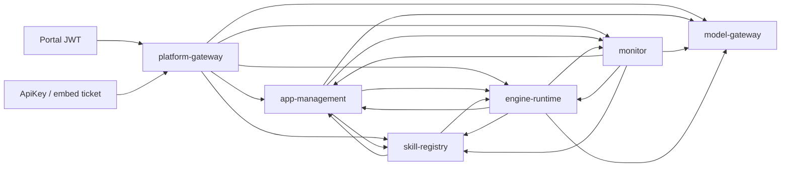

# G6 A 路由能力与生产模式闭锁实施交接

当前仅准备移交，只有root明确交付common源/target后才能实施。唯一工程G:/207/项目/算法重组工具/代码/agent-platform；遵守AGENTS，禁止访问或关联相邻旧代码、配置、数据库、缓存、进程。用户已授权持续开发和隔离端点验证，不重新索要环境。

下方Task1为独立通过计划8b2fb5e7e08907625827d06a592688a868b3e23e0ccd1907d424e96840832d14的原文提取；附实际调用图及当前证据/属性语义，避免仅凭族名前缀猜caller/action。原计划的“本次只规划、未运行”是规划阶段历史，不限制本次经root授权的具体实现；后续Task2–7仍未执行。独立计划审查见review-iam-service-authority-plan.md末节APPROVE_PLAN，不能当功能审查。

## 本任务边界

- 唯一设计v1.2及四契约保持原字节；PG业务权威、跨服务HTTP、Java21/Boot3.5.0固定。仅消费将来的外部IAM，不造生产IAM、密码登录或通用授权服务端。
- 只实现本Task1所列common纯类型/属性语义/显式路由目录、测试与SecurityConfiguration模式装配。只读盘点六服务实际controller和调用端，不改它们的源码、POM、迁移、前端、其他smoke或三份外部台账。
- 本轮不接新生产认证；mode=iam即使字段齐备，缺少后续可信decoder/current-authority装配也必须在开放HTTP listener前拒绝，不能继续使用旧HS256。用最窄的阶段装配拒绝实现，不造额外可由配置伪装的ready开关。显式dev/test现有装配回归保持，不在配置异常时自动降级。
- route JSON逐实际method/controller模板/caller/target/action/mode登记，未使用internal入口明确禁用；不是把表内/admin/**族名当通配能力。resource的具体归属/摘要在未来controller实际绑定后核，目录本身不替代资源授权。新增后续handler必须再明确登记，未知/重复默认拒绝。
- 属性region等许可取交集；dataLabels限制义务保留并集；tenant/sub/biz/user归属相等，缺项不补权，未知属性默认不映射。ADMIN角色不覆盖caller能力。
- 先有最小可编译接缝，再取得真实错误授权/配置启动的行为红，修正转绿；编译错误不算行为红。只用有限小参数/本地随机端口，不读.env/vault/masterkey/实际凭据，不做资源耗尽探针。
- 保留BLOCKED_IAM_SCOPE_ACCEPTANCE；本Task不改生产门禁、不宣称IAM功能或17项/34任务/30验收全完成。

## 交付

起步先存本任务全部common源/POM及实际改动文件的完整baseline与SHA；冻结前后SHA相同、真实完整diff、变更清单、冻结副本及实际补丁apply逐字比对。无HEAD，不用空git diff证明未改。写docs/evidence/iam-stage-1.md，给需求映射、真实行为红/绿/完整common回归、实际阅读开源机制、路由清单覆盖与明确禁用入口、限制。不得提交/发布/package或启停root服务，不派子agent。完成后移交common target供独立审查；root负责统一回归和总台账。

## 原Task1
### Task 1: 固定路由能力、属性语义和生产模式闭锁

**Files:**
- Create: `admin-common/src/main/java/cn/agentplatform/common/authority/ServiceCall.java`、`ResourceBinding.java`、`SubjectKey.java`、`AuthorityProperties.java`、`ServiceRoutePolicy.java`、`ClaimCeiling.java`。
- Create: `admin-common/src/main/resources/agent-service-authority.json`（显式 method/template/caller/target/action/mode）。
- Test: `admin-common/src/test/java/cn/agentplatform/common/authority/AuthorityPolicyTest.java`、`AuthorityConfigurationTest.java`。
- Modify: `admin-common/src/main/java/cn/agentplatform/common/SecurityConfiguration.java`（仅模式装配；未完整配置 iam 时拒绝启动）。

**Interfaces:** `ServiceRoutePolicy.require(String caller,String target,String method,String template)` 返回 `ServiceCall`，无映射抛 PlatformException；`ClaimCeiling.intersect(Set<String>,Set<String>)` 返回不可变交集；`AuthorityProperties.validate()` 抛配置异常而非降级。resource 在 controller 实际绑定后另外核实，路由模板不能充当具体资源授权。

- [ ] 写失败测试，先锁定 caller 与方法分离、ADMIN 不覆盖 caller、未知目标拒绝、空属性缺项不补全、dataLabels 不削弱。纯交集示例可直接编译：

```java
@Test void cannotRestoreRemovedRegion() {
    assertThat(ClaimCeiling.intersect(Set.of("A", "B"), Set.of("A")))
        .containsExactly("A");
    assertThat(ClaimCeiling.intersect(Set.of("A"), Set.of())).isEmpty();
}
```

- [ ] 执行 `mvn.cmd -B -ntp -pl admin-common -am test "-Dmaven.repo.local=.tools/m2" "-Dtest=AuthorityPolicyTest,AuthorityConfigurationTest" -Dsurefire.failIfNoSpecifiedTests=false`；新类缺失只算初始编译接缝失败，不算关键行为红。补最小可编译骨架后，必须先从真实错误授权/非法配置启动路径取得断言失败（例如错误允许或错误启动），再实现校验转绿；旧身份测试不当新安全通过。
- [ ] 实现纯交集核心并完整填写 route JSON；按上面图逐条核 caller，不生成 `*` 权限：

```java
public static Set<String> intersect(Set<String> left, Set<String> right) {
    var result = new HashSet<>(left);
    result.retainAll(right);
    return Set.copyOf(result);
}
```

- [ ] 配置校验拒绝 `iam + dev-auth=true`、portal enabled on engine、authority issuer/jwks/token/decision 缺失、client-id 与 service-id 不绑定、未知 mode；保留 dev/test 的显式独立装配。每条拒绝由参数化启动测试观察无 HTTP listener。
- [ ] 重跑同命令，预期全绿；审查 JSON 对每个 controller method 的覆盖，证据记录哪些未使用 internal handler 保持禁用。Task 1 不接入新生产认证。


## 实际调用图原文

### 实际调用图与初始 action 清单



新增权限目录使用完整 Spring controller 路径模板加 HTTP method，一条模板一个 action；下面为必须覆盖的精确边族，不把族名作为运行时通配授权。`POST` 创建、更新、发布、确认与 `GET` 查看不能共享 action。runtime `RequestMappingHandlerMapping` 枚举全部非健康业务 handler，未登记/重复匹配启动拒绝；网关 Routes 只选择目标，不能授予权限。

| caller → target | 必须登记的路径/用途 | 最小 action 前缀与模式 |
| --- | --- | --- |
| gateway → 五业务服务 | 现有 `/admin/**`、`/v1/**`、`GET /v3/api-docs` 的具体 handler 模板 | `proxy.<target>.<method>.<handler>`；用户委托，integration 仅允许 IntegrationPolicy.allowedPath 的具体运行模板 |
| gateway → app | `GET /internal/integration-credentials/{id}`、`GET /internal/integration-origins` | `integration.credential.read`、`integration.origin.check`；机器身份，仅 gateway |
| 外部 authority 的独立 policy client → app | `POST /internal/iam/integration-policy/resolve` | `integration.policy.resolve`；独立签发/验证域，仅 `iam-policy-resolver`，不用普通 authorizeWorkload，见 §2.6 |
| 已登记的实际材料消费者 → 材料生产服务 engine/skill/model | `GET /internal/material-scopes/{kind}/{id}` | `material.scope.read`；用户委托、完整 subject/resource 绑定；未实际需要的边不授予，见 §2.5 |
| engine/monitor → app | `/internal/apps/{code}/candidate|versions/{version}|snapshot|published`、`/internal/app-drafts/{id}`、prompt-template 版本 | 分别 `app.candidate.read`、`app.version.read`、`app.snapshot.read`、`app.published.read`、`app.draft.read`、`prompt.version.read`；用户委托，只有实际调用边纳入 |
| app → skill/model/engine/monitor | skill 元数据、model-entry/binding freeze/validate、`POST /internal/graphs/validate`、`GET /internal/evaluations/accepted` | 元数据 read 与 freeze/validate 区分；当前 EDITOR/发布要求继续由域服务核对 |
| engine → skill | `GET /internal/skills/{code}`、`GET /internal/skill-versions/{id}`、`POST /internal/skills/{code}/execute`、skill-facts 的 read/reconcile/retry/reproduce-artifacts、reconciliation-proofs | `skill.metadata.read`、`skill.version.read`、`skill.execute`、`skill.fact.read`、`skill.reconcile`、`skill.fact.deliver`、`skill.artifact.reproduce`、`skill.reconciliation-proof.read`；不能互换 |
| skill → engine | `/internal/tool-calls/{id}`、`/{id}/approval`、`/{id}/claim`、`/{id}/submitted`、`/{id}/fact`；受控 draft test | `tool.authority.read`、`tool.approval.read`、`tool.claim`、`tool.submit`、`tool.fact.record`、`skill.draft-test.start`；fact 投递不授予 submit |
| skill → app | `GET /internal/skills/{code}/references` | `skill.references.read`；用户委托 |
| engine → model | `POST /internal/model/measure|chat|chat/stream`，binding/entry 读取或验证 | `model.measure`、`model.chat`、`model.chat-stream` 与元数据动作分开；当前数据标签/出域约束保留 |
| engine → monitor | `POST /internal/datasets/promotions` | `dataset.promote`；仍验证 debug input 所有权和冻结摘要 |
| monitor → engine | evaluations/run、approvals、audit、statistics、statistics/runs/{id} | `evaluation.run`、`approval.decide`、`approval.list`、`audit.read`、`statistics.read`、`statistics.run.read`；确认角色按本调用冻结的 confirmRoles，ADMIN 没有自动豁免 |
| monitor → skill/model | statistics、model statistics/query | `statistics.read`、`statistics.query`；仍要求用户 ADMIN |
| 已批准 callback service → skill | `POST /internal/skill-jobs/{callId}/callback` | `skill.callback.record`，独立注册 client；继续原 SignedCallback/body/time/idempotency/attempt 校验，不把该 client 扩成 engine |

`ToolCallController /register` 即使目前没有跨服务调用者也必须登记为明确禁用，不能因“内部”自动授权；后续新增 caller 另审。同样对现有 controller 中所有无调用边的 internal handler 默认禁用。上述清单是迁移工作表，最终完整逐 handler 清单在 Task 1 生成并逐条评审，运行时绝不从类名或 URL 前缀自动推断允许 caller。


## 证据与属性语义原文

### 2.3 当前证据内容及有效性

建议新增 `admin-common/src/main/java/cn/agentplatform/common/authority/` 包；以下内部接口为各任务统一交接，不改 `Actor` record 的四个字段，也不将敏感票据塞进 attributes 或四契约 JSON：

```java
public record SubjectKey(String tenantId, String principalId) {}
public record ResourceBinding(String kind, String id, String versionDigest) {}
public record ServiceCall(String target, String action, ResourceBinding resource) {}
public record DelegationRef(String value, SubjectKey subject, Instant expiresAt) {}
public record VerifiedAuthority(
    Actor actor, String caller, ServiceCall call, DelegationRef delegation,
    String authorizationVersion, Instant checkedAt, Instant expiresAt, String decisionId,
    OperationBinding operation) {}
public record ServiceTicket(String value, Instant expiresAt, OperationBinding operation) {}
public record WorkloadAuthority(String caller, ServiceCall call,
    String decisionId, Instant checkedAt, Instant expiresAt) {}
public interface CurrentAuthorityClient {
    ServiceTicket client(ServiceCall call);
    ServiceTicket exchange(String subjectToken, ServiceCall call);
    ServiceTicket resume(DelegationRef delegation, ServiceCall call);
    ServiceTicket forward(VerifiedAuthority authority, ServiceCall call);
    VerifiedAuthority authorize(String serviceTicket, ServiceCall call);
    WorkloadAuthority authorizeWorkload(String serviceTicket, ServiceCall call);
    VerifiedAuthority approver(DelegationRef delegation, SubjectKey approver,
                               ResourceBinding approval);
}
public interface ServiceTicketProvider {
    ServiceTicket issue(VerifiedAuthority authority, ServiceCall call);
}
```

这些 public 类型各自同名文件，使用 `cn.agentplatform.common.Actor`、`java.time.Instant`；客户端的 caller 仅来自本机 validated config。`VerifiedAuthority` 的可信性由构造入口纪律和接收端重新验证保证，不能以 Java record 本身防伪；业务请求不得反序列化成该类型。测试可以构造它，生产只能由验签+在线查询后的 mapper 构造。`client(ServiceCall)` 使用 client_credentials 取得纯机器票据，`authorizeWorkload` 验当前机器能力；只供已明确列出的 credential/origin/health 等机器动作，不能生成用户 Actor、用户 grant 或访问其他业务动作。两种内部票据额外使用互斥 `authority_mode=delegated|workload`；workload 的 sub 是可信 client 标识，没有用户 tenant/sub/grant_ref，接收端不得补虚拟用户身份。用户委托票据仍要求完整 tenant/sub/grant_ref。

`authorize` 接口只接已验 service ticket 与本地提取的 target/action/resource，响应必须签名且匹配 request nonce、ticket jti、caller、grant_ref、tenant/sub、resource digest 和查询时间；缺项/错类型/超时/版本回退均拒绝。权限版本是 authority 不透明值，客户端不比较字典序；每次在线读取判 active/current，只有完全匹配的决定可使用。`approver` 查询持久批准记录中的真实 approvedBy，response 必须绑定该批准摘要与主体，禁止传入当前发起人的角色冒充。

有效业务范围 = 原委托上限 ∩ issuer/client 声明上限 ∩ 此刻可信 IAM/集成策略范围 ∩ 具体操作守卫。运行历史仅是上限，不能补回缺失的当前属性。scope action 需完全覆盖目标动作；不同服务的授权决策不能交叉使用。属性按语义处理：`region` 等授权集合取交集；`dataLabels` 等数据敏感级别是限制义务，保留历史材料标签与当前约束的并集，不能求交而删掉保密标签；tenant/sub、biz/user 归属值要求相等，不进行集合补全。未知属性默认不映射。

网络不可用不使用上次成功授权、旧角色或本地签票。有效签名但当前 scope/role 收窄时，新动作和历史受保护材料复用均重新判定；历史材料的所需范围不在当前范围内则拒绝整份复用，不能静默删字段当作安全裁剪。唯一原响应完成例外使用 §2.4.1 独立限用途 permit，不放宽本段普通 current 规则。版本、摘要缺失的旧材料不能假设已获授权。新鲜度只能说明核实时刻；已完成外部副作用不能靠后来撤权撤销。取证在短事务外，事务内复核证据未过期、资源版本/取消/lease/attempt 未变；每次新发送和 G2 claim/submitted 检查点都重新获取证据，不对漫长业务持锁查询 IAM。


## Task1 补全：原计划第4节配置边界

本段同样是批准计划的原文摘录，不新增协议。Task1按本段实施模式/属性装配；其中HTTP/JWT与secret resolver的具体客户端工作仍属后续Task2/3。旧显式dev/test装配须显式配置；缺mode不能被自动解释成dev。当前六主服务仍使用旧已固定制品，不因common源码增量接管或重启；全服务配置迁移留Task4。

## 4. 配置、错误语义与测试数值来源

新增内部属性归 `agent.security.mode`、`agent.security.service-id`、`agent.security.portal`、`agent.security.authority`、`agent.security.integration`，通过 Java `@ConfigurationProperties` 强校验。建议模式 `dev-hmac`、`iam`；生产构建/部署必须显式 `iam`，缺值拒绝启动。`dev-hmac` 必须同时显式 `agent.dev-auth=true`、loopback 绑定和发布门禁仍 blocked；test 单独显式 profile，不从 Host header 推断部署安全。

```yaml
agent:
  security:
    mode: iam
    service-id: engine
    portal:
      enabled: false
    authority:
      issuer: https://iam.example.invalid/agent
      jwks-uri: https://iam.example.invalid/agent/jwks
      token-uri: https://iam.example.invalid/agent/token
      decision-uri: https://iam.example.invalid/agent/decisions
      client-id: engine
      client-secret-ref: env:AGENT_SECRET_IAM_ENGINE_CLIENT
      allowed-algorithm: RS256
      audience: urn:agent-platform:service:engine
      max-ticket-seconds: 60
      max-decision-seconds: 5
      connect-timeout-ms: 1000
      read-timeout-ms: 2000
```

以上域名只用于展示配置形状，不作为可运行默认值；这些 URI 和 secret_ref 都必须由部署配置注入。生产只允许显式 HTTPS trust origins，禁止 token 的 jku/x5u/iss 派生网络目标、禁止重定向；test loopback HTTP 例外只在 test profile。gateway 独立配置 portal issuer/aud/client/role/attribute allowlist 和 integration 专用密钥引用，其他服务禁止 portal/integration enabled。实际读过 `admin-common/src/main/java/cn/agentplatform/common/SecretVault.java` 源码：现有 env/vault resolver 按用户 tenant 绑定，不能用伪造 Actor 解决 IAM client 的启动凭据循环；新增仅接受配置中的本服务 workload secret_ref 的 resolver，固定 `service-id → client-id → env 名` 绑定，不能解析请求给的引用，不改现有业务 SecretVault 语义。本次没有读取任何 vault 数据或环境变量值。

| 数值 | 来源和用途 |
| --- | --- |
| 集成 ≤5 min，即 300 秒 | 设计 snapshot:279、:2885，现有 ServiceTokens 已限制 1..300 |
| 旧内部 120 秒、dev 用户 3600 秒；恢复 3000 ms、16 条、失败 30 秒；outbox 8 条、2 秒 | 当前实现值，描述现状，不能升级成设计硬约束 |
| 内部票据 ≤60 秒、当前证据 ≤5 秒、时间 skew 0 秒 | 本计划建议且已由root接受为首版保守软件默认；不是设计原值或生产SLA。严格 fail-closed，测试注入 Clock，不 sleep 等过期 |
| 连接 1 秒、读取 2 秒、JWT ≤16 KiB、JWKS/决定响应 ≤64 KiB、小 JWKS ≤8 把公钥 | 本计划保守建议，只用小有效/无效样本验边界，不进行耗尽/慢速攻击测试 |
| 初版授权决定缓存 0、初版验签公钥每次从已配置端点获取 | 简化撤权/故障语义的建议；明确拒绝陈旧网络结果。后续缓存优化需单独审查轮换/撤销窗口，不偷偷沿用库默认缓存 |
| resolver独立固定公钥≤2、policy assertion≤30秒、流watchdog最多1秒一次 | 本次返修建议值；resolver为避免递归使用独立部署公钥域，不适用普通JWKS每次在线获取。watchdog与证据≤5秒构成软件检查窗口，不声称生产撤权SLA；以Clock/闩锁验收 |

入口无效签名/issuer/aud/purpose/exp/kid 为 401 `SYS-AUTH-401`；已验主体但 caller/action/resource/guard 被拒为 403 `SYS-AUTH-403`；IAM 网络/不可验证响应为 503 `IAM_AUTHORITY_UNAVAILABLE`，controller/adapter 未执行；无持久授权引用为 403 `AUTHORITY_CONTEXT_MISSING`。沿用 `ApiResponse`/`PlatformException`，不把 401/403 包装成普通 UPSTREAM_ERROR 后盲目重试。日志只记录 correlation/decisionId 的非秘密摘要、action 和错误类别，不输出票据、grant_ref 明文、Authorization 或 secret。

